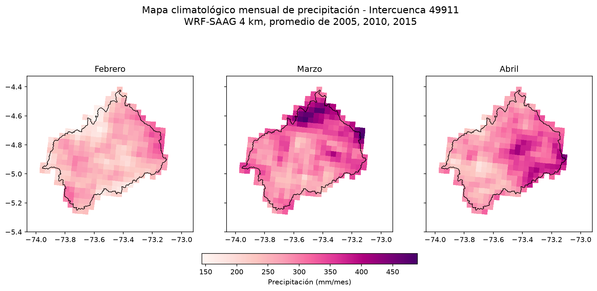
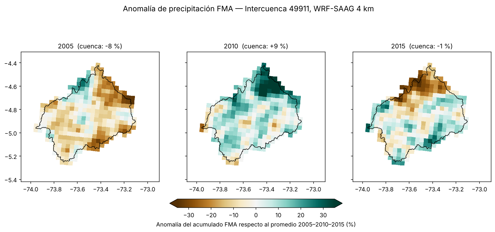

# Evaluación de la precipitación diaria simulada con WRF a escala convectiva (4 km) en la cuenca del Ucayali: febrero–abril de 2005, 2010 y 2015

Proyecto del **Taller de Hidroclima y simulaciones de convección explícita en Sudamérica tropical**.

## Objetivo

Caracterizar y evaluar la **precipitación diaria acumulada** de la simulación **WRF-SAAG (NCAR, 4 km, convección explícita)** en el bajo Ucayali durante **FMA (febrero–abril)** de 2005, 2010 y 2015, comparándola con PISCO, IMERG y ERA5.

FMA es el final de la estación lluviosa. 2005 y 2010 fueron años de sequía amazónica y 2015 de El Niño.

Preguntas guía:
1. ¿Qué tan bien reproduce el WRF a 4 km el acumulado de FMA y su distribución espacial?
2. ¿Representa bien la frecuencia de días lluviosos y la intensidad diaria, incluidos los extremos?
3. ¿Dónde falla más dentro de la cuenca?
4. ¿Mejora respecto a ERA5, que es su forzante?
5. ¿Distingue las diferencias entre 2005, 2010 y 2015?

## Dominio

| | |
|---|---|
| Caja | 5.3–4.4°S, 74.0–73.0°W (bajo Ucayali, entre Requena y Nauta) |
| Malla SAAG | 28 × 30 puntos de 4 km, índices `y[1439:1467] x[292:322]` |
| Cuenca | **Intercuenca 49911** (ANA, Bajo Ucayali, 4353 km²): `cuenca/49911.shp`, incluida en el repo |
| Relieve | llano amazónico, 90–180 m |

La caja se define en `scripts/config.py`. Los mapas y estadísticas usan solo las 330 celdas de 4 km que tocan la cuenca.

## Datos

| Base | Uso | Resolución | Acceso |
|---|---|---|---|
| **WRF-SAAG** (GDEX d616000) | Modelo evaluado | 4 km, horaria → diaria | OPeNDAP, sin cuenta |
| **PISCO-prec** (SENAMHI) | Referencia principal | 0.1°, diaria | Libre |
| **GPM IMERG V07** (GPM_3IMERGHH) | Referencia satelital | 0.1°, 30 min → diaria | NASA Earthdata |
| **ERA5** | Forzante / contraste | 0.25°, horaria → diaria | Copernicus CDS |

**Día pluviométrico:** todos los productos se acumulan con la misma ventana, definida en `scripts/config.py` (`DIA_INICIO_UTC`). Por defecto es 12 UTC, es decir de 07:00 a 07:00 hora local, que es la convención de las estaciones de SENAMHI y permite comparar con PISCO. La fecha de cada día es la del inicio de la ventana.

Instrucciones de descarga: [`docs/datos.md`](docs/datos.md).

## Estado de los resultados (SAAG)

| Año | `.nc` diario | Mapas | CSV | Responsable |
|---|---|---|---|---|
| 2005 | ✅ | ✅ | ✅ | brunedu21 |
| 2010 | ✅ | ✅ | ✅ | giswllmp (extracción y mapas; `.nc` y CSV subidos por rcrafa179) |
| 2015 | ✅ | ✅ | ✅ | rcrafa179 |
| Climatología y análisis (combinado) | — | ✅ | ✅ | rcrafa179 |

| PISCO (imágenes) | — | ⏳ en `figures/pisco/` | — | AllSJ-23 |
| ERA5 (comparación) | ⏳ `era5_pr_diaria_FMA_<año>.nc` | ⏳ `era5_comparacion_*` | ⏳ | — |
| PISCO (comparación) | ⏳ `pisco_pr_diaria_FMA_<año>.nc` | ⏳ `pisco_comparacion_*` | ⏳ | — |

Pendiente: subir las figuras de PISCO (ver [`figures/pisco/README.md`](figures/pisco/README.md)) y comparar cuantitativamente con PISCO, IMERG y ERA5 (preguntas 1–4). Para una comparación numérica hace falta el archivo de datos de PISCO (NetCDF diario), no solo imágenes.

## Resultados

Todo lo que sigue es **WRF-SAAG (4 km) sobre la Intercuenca 49911**, FMA de 2005, 2010 y 2015, con día pluviométrico de 07:00 a 07:00 hora local. Todavía **no hay comparación con observaciones**, así que se describe lo que simula el modelo, no si acierta. Los números salen de `figures/mapas_resumen_mensual_todos.csv` y `figures/analisis_resumen_FMA.csv`, y se reproducen con `python scripts/04_mapas_mensuales.py --combinado` y `python scripts/07_analisis.py`.

### Resumen por año

| | 2005 | 2010 | 2015 |
|---|---|---|---|
| Acumulado FMA, media de la cuenca (mm) | 785 | **933** | 840 |
| Anomalía respecto al promedio de los 3 años | −8 % | **+9 %** | −1 % |
| Rango entre celdas (mm) | 521–1152 | 604–1541 | 434–1270 |
| Febrero / Marzo / Abril (mm) | 166 / 296 / 322 | 373 / 307 / 253 | 192 / 342 / 306 |
| Días con lluvia ≥ 1 mm (media de la cuenca) | 64 | 65 | **70** |
| Días con lluvia ≥ 1 mm (por celda, promedio) | 44 | 48 | **50** |
| Intensidad media en días con lluvia (mm/día) | 17.4 | **19.5** | 16.6 |
| Percentil 95 diario por celda (mm/día) | 61 | **63** | 55 |
| Máximo diario en una celda (mm) | 179 | **200** | 167 |
| Día más lluvioso, media de la cuenca | 23-mar: **56 mm** | 9-mar: 48 mm | 1-abr: 43 mm |
| Días con más de 20 mm en la media de la cuenca | 15 | **22** | 10 |
| Lluvia caída en el 10 % de días más lluviosos | **43 %** | 32 % | 33 % |

### 1. Distribución espacial y ciclo mensual



- **Marzo es el mes más lluvioso** en promedio (315 mm), seguido de abril (294 mm) y febrero (244 mm). En los tres años, febrero es el mes con más variación: va de 166 mm en 2005 a 373 mm en 2010.
- **La lluvia no es uniforme dentro de la cuenca.** El oeste y el suroeste (hacia Requena) reciben menos, unos 150–250 mm/mes. En marzo hay un núcleo de 400–480 mm/mes en el norte (hacia Nauta) y en abril se desplaza al este y sureste de la cuenca. Dentro de una cuenca de solo 4353 km², el acumulado FMA de una celda puede ser **2 a 3 veces** el de otra.
- Como el terreno es plano (90–180 m), esta estructura no viene del relieve. Es la huella de sistemas convectivos organizados que el modelo resuelve explícitamente a 4 km. Con solo tres años, parte de ese patrón todavía es "ruido" de unas pocas tormentas grandes, no un rasgo climatológico.

Mapas de cada año: [2005](figures/mapas_total_2005.png), [2010](figures/mapas_total_2010.png), [2015](figures/mapas_total_2015.png). Días con lluvia: [2005](figures/mapas_diaslluvia_2005.png), [2010](figures/mapas_diaslluvia_2010.png), [2015](figures/mapas_diaslluvia_2015.png).

### 2. Diferencias entre años



- **2010 es el FMA más lluvioso (+9 %)**, sobre todo por un febrero muy húmedo (373 mm, más del doble que en 2005). El exceso se concentra en el norte de la cuenca, donde pasa del +30 %.
- **2005 es el más seco (−8 %)**, con déficit en casi toda la cuenca y más marcado en el este. Su febrero fue el más seco de los tres, aunque abril fue el más lluvioso.
- **2015 queda en el promedio (−1 %)**, pero con un dipolo: el norte está seco (−20 a −30 %) y el centro-sur es más húmedo.
- **Las sequías amazónicas de 2005 y 2010 no se ven en FMA.** Esas sequías fueron sobre todo de la estación seca (julio a octubre), y en febrero–abril 2010 es justamente el año más lluvioso. Para la sequía habría que mirar otros meses, y para El Niño 2015 su desarrollo posterior.

### 3. Variabilidad diaria, intensidad y extremos


- La lluvia llega en **pulsos de 1–3 días** con 20–55 mm de media en la cuenca, separados por días casi secos. Es el comportamiento típico de la convección amazónica.
- **2005 es el año más concentrado:** el 43 % de su lluvia de FMA cayó en solo 8 días, y tiene el día más intenso de la cuenca (23 de marzo, 56 mm). Febrero y la primera mitad de marzo fueron muy secos.
- **2010 tiene más días fuertes:** 22 días con más de 20 mm en la media de la cuenca, y un inicio de febrero con lluvia casi diaria.
- **2015 llueve más seguido pero menos intenso:** es el año con más días de lluvia (70) y con la menor intensidad media y el menor percentil 95. Su lluvia está más repartida en el tiempo.


- Las distribuciones de lluvia diaria por celda son casi iguales hasta unos 50 mm/día. Las diferencias entre años aparecen en la cola: 2010 y 2005 tienen más días de más de 100 mm que 2015, y el máximo de una celda llega a 200 mm/día en 2010.
- Por celda, llueve (≥ 1 mm) en la mitad de los días de FMA (44–50 de 89). En cambio, la media de la cuenca supera 1 mm en 64–70 días: casi siempre está lloviendo en *alguna* parte de la cuenca.

### Conclusiones preliminares y cautelas

1. En la Intercuenca 49911, el WRF-SAAG simula unos **780–930 mm entre febrero y abril**, con **marzo como mes más lluvioso** y un gradiente de **menos lluvia al oeste y más al norte y al este**.
2. Las diferencias entre años son moderadas en el total (±9 %), pero grandes en el reparto mensual (febrero) y en cómo se concentra la lluvia (2005 frente a 2015).
3. **Falta la evaluación.** Sin PISCO, IMERG y ERA5 no se puede decir si estos totales, gradientes o extremos son reales o sesgos del modelo. Es el siguiente paso.
4. **Tres años no son una climatología.** Lo que aquí se llama "climatología" es el promedio de 2005, 2010 y 2015, útil solo como referencia para comparar esos años entre sí.
5. Los máximos aislados de una sola celda (más de 150 mm/día) deben tomarse con cuidado: a 4 km una tormenta puede caer en un punto en el modelo y unos km más allá en la realidad.

## Estructura

```
scripts/          código (config.py = caja, años, meses, rutas)
cuenca/           shapefile de la Intercuenca 49911 (sí se sube)
data/raw/         datos crudos descargados (NO se suben)
data/processed/   resultado diario FMA por año (sí se sube, < 1 MB por año)
data/aux/         otros insumos locales (DEM, etc.)
figures/          mapas y tablas de resultados (sí se suben)
notebooks/        análisis exploratorio
docs/             plan de trabajo y notas
```

## Instalación

```bash
conda env create -f environment.yml      # crea el entorno "ucayali"
conda activate ucayali
```

Si usan el entorno del curso (`taller-rhia`), solo hay que agregar:
```bash
conda activate taller-rhia
mamba install -c conda-forge xesmf regionmask
```
Los mapas leen el shapefile sin geopandas, así que no les afecta el error de PROJ/pyogrio que aparece en algunos entornos.

## Scripts

Todos los comandos se corren **desde la raíz del repo**.

| Script | Qué hace |
|---|---|
| `01_extraer_saag.py` | Lee de NCAR solo la caja del dominio, hora por hora, y guarda la lluvia diaria FMA de un año |
| `02_descargar_era5.py` | Descarga ERA5 horario de FMA (guarda tu clave con `--clave`) |
| `02b_descargar_pisco.py` | Descarga PISCOp v2.1 diario de FMA (sin cuenta) |
| `03_diario_obs.py` | Pasa ERA5, IMERG o PISCO a diario con el mismo día pluviométrico |
| `04_mapas_mensuales.py` | Mapas mensuales y CSV de resumen sobre la cuenca |
| `05_wrf_ctrl.py` | Corridas locales `WRF2d_CTRL_*.nc` de otro dominio (solo uso local, ver abajo) |
| `06_subir_anio.py` | Sube al repo los resultados de un año, siempre de la misma forma |
| `07_analisis.py` | Serie diaria, anomalías, intensidad y extremos de todos los años (sección Resultados) |
| `08_comparar.py` | Compara SAAG con ERA5 o PISCO sobre la cuenca: totales, sesgo, correlación, extremos, mapas y chequeo de fechas |

### 1. Extraer SAAG

```bash
python scripts/01_extraer_saag.py prueba --workers 20    # verifica acceso y mide la velocidad con un día
python scripts/01_extraer_saag.py 2010 --workers 20      # FMA 2010 (2136 horas, ~1–2 h)
```

- Son 2136 lecturas por año, una por hora, porque SAAG no guarda acumulados de más de una hora.
- `--workers 20` funciona bien. Si aparecen muchos reintentos o la velocidad cae (por ejemplo, porque varios del grupo descargan a la vez), bajen a 12.
- Cada minuto imprime una línea de estado: avance, velocidad de los últimos 5 min, reintentos, horas fallidas y tiempo restante.
- Es reanudable: guarda un archivo por mes en `data/raw/saag/<año>/` y, si se corta, al relanzar salta los meses ya hechos.
- Al final debe decir **`89 días`** y **`incompletos: 0`**.

Salida: `data/processed/saag_pr_diaria_FMA_<año>.nc`, con `pr` (mm/día), `n_horas` (horas válidas por día) y `HGT`.

### 2. Mapas y tablas

```bash
python scripts/04_mapas_mensuales.py 2010          # solo los archivos de 2010
python scripts/04_mapas_mensuales.py --combinado   # climatología y CSV con todos los años (coordinación)
```

Por año:
- `figures/mapas_total_<año>.png`: acumulado mensual (mm/mes), un panel por mes.
- `figures/mapas_diaslluvia_<año>.png`: días con lluvia ≥ 1 mm.
- `figures/mapas_resumen_mensual_<año>.csv`: promedio, mínimo y máximo sobre la cuenca por mes.

Con `--combinado`:
- `figures/mapas_climatologia.png`: promedio de los años, por mes.
- `figures/mapas_resumen_mensual_todos.csv`: las tablas de todos los años juntas.

Por defecto usa `cuenca/49911.shp`; para usar otra cuenca: `--shp otra.shp`. Los días con horas faltantes no entran en los acumulados (el script avisa). Si unos pocos valores extremos dominan la escala de color, esta se satura en el percentil 99 (barra con flecha).

### 3. Comparación con ERA5 y PISCO

#### ERA5

**Una sola vez:**
1. Crear una cuenta en https://cds.climate.copernicus.eu.
2. Copiar el *Personal Access Token* desde https://cds.climate.copernicus.eu/profile.
3. Aceptar la licencia de *ERA5 hourly data on single levels*: pestaña **Download** de https://cds.climate.copernicus.eu/datasets/reanalysis-era5-single-levels, al final de la página. Sin esto, la descarga falla con un error de licencia.
4. Guardar la clave:
   ```bash
   python scripts/02_descargar_era5.py --clave TU-TOKEN
   ```
   Se guarda en `~/.cdsapirc`, **fuera del repo**. Nunca la peguen en un script ni la suban.

**Descargar, pasar a diario y comparar** (2005, 2010 y 2015; o indicar un año):
```bash
python scripts/02_descargar_era5.py          # 4 pedidos por año (feb, mar, abr y 1-may), unos MB
python scripts/03_diario_obs.py era5         # mismo día pluviométrico que SAAG
python scripts/08_comparar.py era5
```

La descarga cubre 4.25–5.5°S y 74.25–72.75°W, alineada a la malla de 0.25° de ERA5 e incluyendo las celdas del borde. Cada pedido espera en la cola de Copernicus: puede tardar de segundos a varios minutos. Si se corta, al relanzar salta los meses ya descargados.

Cómo se compara:
- **Media de la cuenca:** en SAAG, el promedio de sus 330 celdas de 4 km. En ERA5, el promedio de sus celdas de 0.25° ponderado por el área que cae dentro de la cuenca (unas 14 celdas, equivalentes a ~6 completas).
- **Mapas:** el SAAG también se promedia en la malla de ERA5, para que la diferencia SAAG − ERA5 sea entre campos de la misma resolución.

Salidas en `figures/`:
- `era5_comparacion_resumen.csv`: totales, sesgo (mm y %), correlación diaria y semanal, RMSE, días lluviosos, días de más de 20 mm, percentil 95 y máximos.
- `era5_comparacion_mensual.csv`: acumulado de cada mes en SAAG y ERA5.
- Figuras: series diarias (`era5_comparacion_serie.png`), barras mensuales (`..._mensual.png`), dispersión y curva de excedencia (`..._dispersion.png`) y mapas (`..._mapas.png`).

ERA5 no es una observación: es el reanálisis que fuerza al WRF. La comparación responde la pregunta 4 (¿qué aporta resolver la convección a 4 km?), no si el modelo acierta. Para eso hace falta PISCO o IMERG.

#### PISCO (referencia observacional)

PISCOp v2.1 (SENAMHI) versión *stable* tiene datos diarios de 1981 a 2016, a 0.1°. Se descarga recortado desde la [IRI Data Library](https://iridl.ldeo.columbia.edu/SOURCES/.SENAMHI/.HSR/.PISCO/.Prec/.v2p1/), **sin cuenta**:
```bash
python scripts/02b_descargar_pisco.py        # FMA 2005, 2010 y 2015 (+1 día a cada lado), unos kB
python scripts/03_diario_obs.py pisco
python scripts/08_comparar.py pisco
```
Si la descarga falla (por ejemplo por la red de la universidad), el script imprime la URL. Ábranla en el navegador y guarden el archivo como `data/raw/pisco/pisco_pr_<año>.nc`.

**Fechas:** PISCO ya viene diario. Por convención de SENAMHI, el día D es la lluvia de 07:00 de D a 07:00 de D+1, igual que nuestro día pluviométrico, pero no está confirmado cómo etiqueta PISCO la fecha. Por eso `08_comparar.py` imprime la correlación con SAAG desplazando PISCO −1, 0 y +1 días. Si el máximo no está en 0, el script indica qué valor poner en `PISCO_DESFASE_DIAS` (`scripts/config.py`); luego hay que rehacer `03_diario_obs.py pisco` y la comparación.

Salidas: `figures/pisco_comparacion_*`, iguales a las de ERA5. Con PISCO sí se evalúa el modelo (preguntas 1–3), con la cautela de que en el llano amazónico PISCO tiene pocas estaciones y depende más del satélite.

### Corridas WRF del otro dominio (solo uso local)

Los archivos `WRF2d_CTRL_*.nc` son recortes de la misma simulación WRF-SAAG sobre otro dominio (15.6–7.7°S, 77.0–70.5°W: Ucayali alto y medio, con los Andes). La Intercuenca 49911 queda fuera de ese dominio.

```bash
python scripts/05_wrf_ctrl.py ~/Downloads                         # diario FMA, ciclo diurno y lluvia vs altura
python scripts/04_mapas_mensuales.py --fuente wrfctrl --combinado
```

Todos sus resultados (`wrfctrl_*`) están en `.gitignore` y **no se suben**.

## Cómo subir resultados al repositorio

Cada integrante sube **solo los archivos de su año**. Todos llevan el año en el nombre, así nadie sobrescribe a nadie.

| Archivo | Quién lo sube |
|---|---|
| `data/processed/saag_pr_diaria_FMA_<año>.nc` | quien extrajo ese año |
| `figures/mapas_total_<año>.png` | quien extrajo ese año |
| `figures/mapas_diaslluvia_<año>.png` | quien extrajo ese año |
| `figures/mapas_resumen_mensual_<año>.csv` | quien extrajo ese año |
| `figures/mapas_climatologia.png`, `figures/mapas_resumen_mensual_todos.csv` | solo la coordinación, al final |

**Para cada año** (ejemplo 2010):
```bash
git pull
python scripts/01_extraer_saag.py 2010 --workers 20
python scripts/06_subir_anio.py 2010
```
`06_subir_anio.py` comprueba que el `.nc` esté completo, genera los mapas y el CSV del año si faltan y sube **exactamente esos 4 archivos**. Si algunos ya estaban subidos, solo sube los que faltan.

**No suban archivos a mano ni usen `git add .`.** Así se olvida el `.nc` o se pisan las figuras combinadas.

**Al final (coordinación)**, con los tres `.nc` ya en el repo:
```bash
git pull
python scripts/04_mapas_mensuales.py --combinado
git add figures/mapas_climatologia.png figures/mapas_resumen_mensual_todos.csv
git commit -m "Climatología FMA 2005-2010-2015" && git push
```
Como los `.nc` están en el repo, esto no requiere volver a descargar nada.

## Configurar git (una vez por computadora)

1. **Aceptar la invitación** de colaborador en `https://github.com/rcrafa179/ucayali-precip-saag/invitations`.
2. **Iniciar sesión** con `gh auth login` (GitHub.com → HTTPS → navegador), o con un token *classic* que tenga marcado el permiso **`repo`**. GitHub no acepta la contraseña de la cuenta, y un token *fine-grained* puede no tener acceso a un repo de otra cuenta. Si `git push` responde `403 ... denied to <usuario>`, el token no tiene ese permiso: creen uno nuevo y borren el anterior con
   ```bash
   printf "protocol=https\nhost=github.com\n\n" | git credential reject
   ```
3. **Usar un correo verificado en GitHub**, para que los commits cuenten como suyos y aparezcan en *Contributors*:
   ```bash
   git config --global user.name "Nombre Apellido"
   git config --global user.email "correo-verificado-en-github@ejemplo.com"
   ```
   Si el correo que ya usaron no está en su cuenta, agréguenlo en GitHub → Settings → Emails. Los commits anteriores se les asignan solos.

## Reglas del grupo

- **Sí se suben:** `data/processed/saag_*`, `figures/` y `cuenca/`. **No se suben:** `data/raw/`, `wrfctrl_*` ni credenciales (`.cdsapirc`, `.netrc`). El `.gitignore` ya lo controla.
- Los resultados de cada año se suben directo a `main` con `06_subir_anio.py`. Para cambios en el código, mejor una rama (`git checkout -b nombre/tarea`) y un Pull Request.
- Los parámetros comunes (caja, años, meses, día pluviométrico, rutas) solo se cambian en `scripts/config.py`.
- Antes de hacer commit de un notebook, limpien las salidas pesadas o usen `nbstripout`.
- Los datos crudos están en **UTC**.

## Cita del dataset principal

Rasmussen, R., Liu, C., Ikeda, K., Dominguez, F. (2022). *Multi-decadal Convection-permitting Simulation of Current Climate over South America using WRF*. NSF NCAR. https://doi.org/10.5065/6XQW-ZB02
