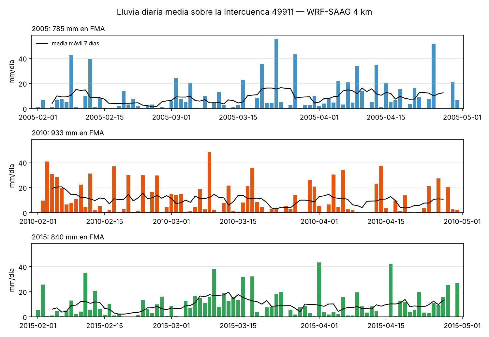
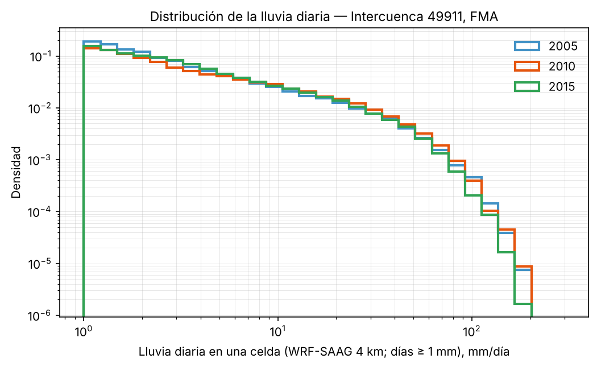
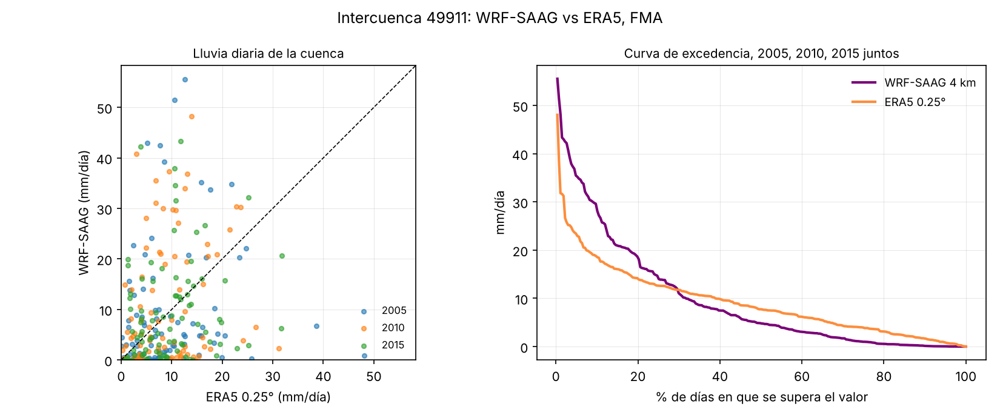
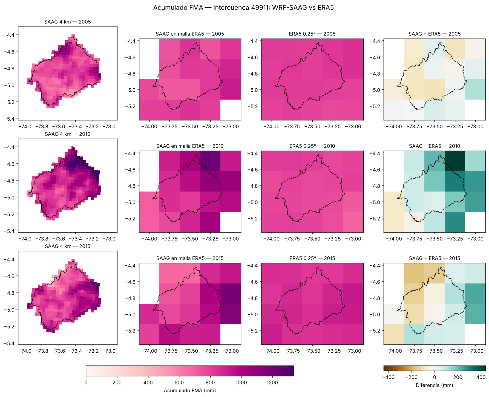
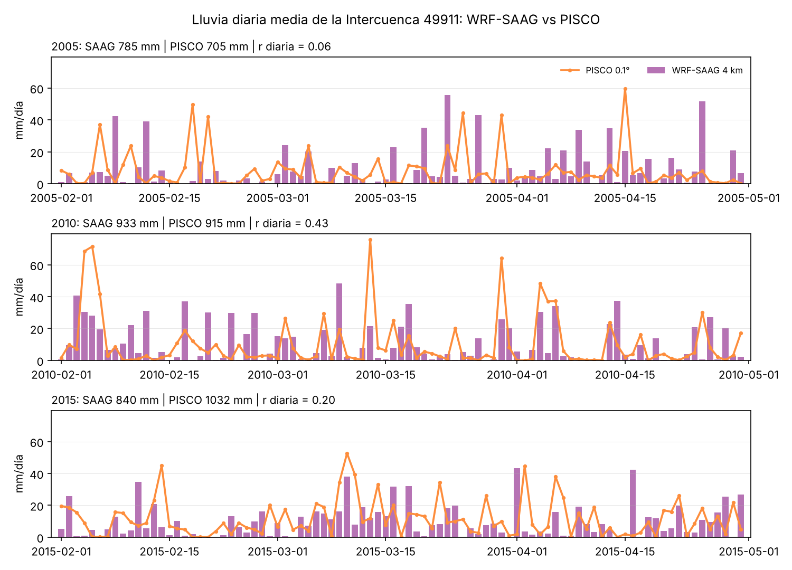
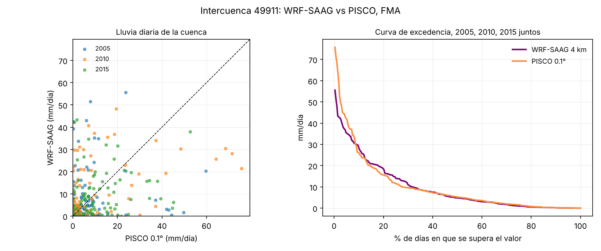

# Evaluación de la precipitación diaria simulada con WRF a escala convectiva (4 km) en la cuenca del Ucayali: febrero–abril de 2005, 2010 y 2015

Proyecto del **Taller de Hidroclima y simulaciones de convección explícita en Sudamérica tropical**.

## Objetivo

Caracterizar y evaluar la **precipitación diaria acumulada** de la simulación **WRF-SAAG (NCAR, 4 km, convección explícita)** en el bajo Ucayali durante **FMA (febrero–abril)** de 2005, 2010 y 2015, comparándola con PISCO, IMERG y ERA5.

FMA es el final de la estación lluviosa. 2005 y 2010 fueron años de sequía amazónica [12–15] y 2015 de El Niño [16, 17]. La simulación evaluada se describe en [1, 2] y la referencia observacional en [7].

Preguntas guía:
1. ¿Qué tan bien reproduce el WRF a 4 km el acumulado de FMA y su distribución espacial?
2. ¿Representa bien la frecuencia de días lluviosos y la intensidad diaria, incluidos los extremos?
3. ¿Dónde falla más dentro de la cuenca?
4. ¿Mejora respecto a ERA5, que es su forzante?
5. ¿Distingue las diferencias entre 2005, 2010 y 2015?

## Dominio

| | |
|---|---|
| Caja | 5.3–4.4°S, 74.0–73.0°W (bajo Ucayali, entre Requena y Nauta) |
| Malla SAAG | 28 × 30 puntos de 4 km, índices `y[1439:1467] x[292:322]` |
| Cuenca | **Intercuenca 49911** (ANA, Bajo Ucayali, 4353 km²): `cuenca/49911.shp`, incluida en el repo |
| Relieve | llano amazónico, 90–180 m |

La caja se define en `scripts/config.py`. Los mapas y estadísticas usan solo las 330 celdas de 4 km que tocan la cuenca.

## Datos

| Base | Uso | Resolución | Acceso |
|---|---|---|---|
| **WRF-SAAG** (GDEX d616000) | Modelo evaluado | 4 km, horaria → diaria | OPeNDAP, sin cuenta |
| **PISCO-prec** (SENAMHI) | Referencia principal | 0.1°, diaria | Libre |
| **GPM IMERG V07** (GPM_3IMERGHH) | Referencia satelital | 0.1°, 30 min → diaria | NASA Earthdata |
| **ERA5** | Forzante / contraste | 0.25°, horaria → diaria | Copernicus CDS |

**Día pluviométrico:** todos los productos se acumulan con la misma ventana, definida en `scripts/config.py` (`DIA_INICIO_UTC`). Por defecto es 12 UTC, es decir de 07:00 a 07:00 hora local, que es la convención de las estaciones de SENAMHI y permite comparar con PISCO. La fecha de cada día es la del inicio de la ventana.

Instrucciones de descarga: [`docs/datos.md`](docs/datos.md).

## Estado de los resultados (SAAG)

| Año | `.nc` diario | Mapas | CSV | Responsable |
|---|---|---|---|---|
| 2005 | ✅ | ✅ | ✅ | brunedu21 |
| 2010 | ✅ | ✅ | ✅ | giswllmp  |
| 2015 | ✅ | ✅ | ✅ | rcrafa179 |
| Climatología y análisis (combinado) | — | ✅ | ✅ | rcrafa179 |

| PISCO climatología 1981–2005 (imagen) | — | ✅ `figures/pisco/` | — | AllSJ-23 |
| ERA5 (comparación) | ✅ `era5_pr_diaria_FMA_<año>.nc` | ✅ `era5_comparacion_*` | ✅ | rcrafa179 |
| PISCO (comparación) | ✅ `pisco_pr_diaria_FMA_<año>.nc` | ✅ `pisco_comparacion_*` | ✅ | rcrafa179 |

Pendiente: IMERG (opcional) para una segunda referencia observacional (ver [`figures/pisco/README.md`](figures/pisco/README.md)) y comparar cuantitativamente con PISCO, IMERG y ERA5 (preguntas 1–4). Para una comparación numérica hace falta el archivo de datos de PISCO (NetCDF diario), no solo imágenes.

## Resultados

Todo lo que sigue es **WRF-SAAG (4 km) sobre la Intercuenca 49911**, FMA de 2005, 2010 y 2015, con día pluviométrico de 07:00 a 07:00 hora local. Todavía **no hay comparación con observaciones**, así que se describe lo que simula el modelo, no si acierta. Los números salen de `figures/mapas_resumen_mensual_todos.csv` y `figures/analisis_resumen_FMA.csv`, y se reproducen con `python scripts/04_mapas_mensuales.py --combinado` y `python scripts/07_analisis.py`.

### Archivos de resultados

Todo está en `figures/` (tablas `.csv` que se abren en Excel) y `data/processed/` (NetCDF):

| Archivo | Qué contiene |
|---|---|
| `saag_diaria_cuenca_<año>.csv` | **Lluvia diaria de SAAG** en la cuenca, un día por fila: media, mediana, mínimo y máximo entre celdas (mm), % de la cuenca con lluvia ≥ 1 mm y si el día está completo |
| `pisco_diaria_cuenca_<año>.csv` | Lo mismo para PISCO |
| `saag_estaciones_mensual.csv` | SAAG en la celda de 4 km más cercana a Genaro Herrera (−4.906, −73.650) y Bagazán (−4.910, −73.604), y media 3×3: lluvia mensual y días con lluvia, para comparar con las estaciones y PISCO v3 |
| `tres_fuentes_diaria.csv` | Lluvia diaria media de la cuenca de **SAAG, ERA5 y PISCO**, lado a lado (267 días) |
| `mapas_resumen_mensual_<año>.csv`, `..._todos.csv` | Acumulado mensual de SAAG (media, mín. y máx. de la cuenca) y días con lluvia; con prefijo `pisco_`, lo mismo para PISCO |
| `analisis_resumen_FMA.csv` | Resumen de FMA por año de SAAG: totales, intensidad, extremos y concentración; con prefijo `pisco_`, lo mismo para PISCO |
| `era5_comparacion_*.csv`, `pisco_comparacion_*.csv` | Comparación de SAAG con cada referencia: resumen por año y por mes |
| `tres_fuentes_resumen.csv` | SAAG y ERA5 frente a PISCO (pregunta 4) |
| `data/processed/<fuente>_pr_diaria_FMA_<año>.nc` | Campos diarios completos (todas las celdas), para quien quiera hacer otros cálculos |

En los CSV diarios de una sola fuente, SAAG promedia sus 330 celdas de 4 km que tocan la cuenca y PISCO sus 54 celdas de 0.1°. En `tres_fuentes_diaria.csv`, ERA5 y PISCO se ponderan por el área de cada celda que cae dentro de la cuenca, por eso PISCO difiere ~1 % entre ambos archivos.

### Resumen por año

| | 2005 | 2010 | 2015 |
|---|---|---|---|
| Acumulado FMA, media de la cuenca (mm) | 785 | **933** | 840 |
| Anomalía respecto al promedio de los 3 años | −8 % | **+9 %** | −1 % |
| Rango entre celdas (mm) | 521–1152 | 604–1541 | 434–1270 |
| Febrero / Marzo / Abril (mm) | 166 / 296 / 322 | 373 / 307 / 253 | 192 / 342 / 306 |
| Días con lluvia ≥ 1 mm (media de la cuenca) | 64 | 65 | **70** |
| Días con lluvia ≥ 1 mm (por celda, promedio) | 44 | 48 | **50** |
| Intensidad media en días con lluvia (mm/día) | 17.4 | **19.5** | 16.6 |
| Percentil 95 diario por celda (mm/día) | 61 | **63** | 55 |
| Máximo diario en una celda (mm) | 179 | **200** | 167 |
| Día más lluvioso, media de la cuenca | 23-mar: **56 mm** | 9-mar: 48 mm | 1-abr: 43 mm |
| Días con más de 20 mm en la media de la cuenca | 15 | **22** | 10 |
| Lluvia caída en el 10 % de días más lluviosos | **43 %** | 32 % | 33 % |

### 1. Distribución espacial y ciclo mensual


- **Marzo es el mes más lluvioso** en promedio (315 mm), seguido de abril (294 mm) y febrero (244 mm). En los tres años, febrero es el mes con más variación: va de 166 mm en 2005 a 373 mm en 2010.
- **La lluvia no es uniforme dentro de la cuenca.** El oeste y el suroeste (hacia Requena) reciben menos, unos 150–250 mm/mes. En marzo hay un núcleo de 400–480 mm/mes en el norte (hacia Nauta) y en abril se desplaza al este y sureste de la cuenca. Dentro de una cuenca de solo 4353 km², el acumulado FMA de una celda puede ser **2 a 3 veces** el de otra.
- Como el terreno es plano (90–180 m), esta estructura no viene del relieve. Es la huella de sistemas convectivos organizados que el modelo resuelve explícitamente a 4 km. Con solo tres años, parte de ese patrón todavía es "ruido" de unas pocas tormentas grandes, no un rasgo climatológico.

Mapas de cada año: [2005](figures/mapas_total_2005.png), [2010](figures/mapas_total_2010.png), [2015](figures/mapas_total_2015.png). Días con lluvia: [2005](figures/mapas_diaslluvia_2005.png), [2010](figures/mapas_diaslluvia_2010.png), [2015](figures/mapas_diaslluvia_2015.png).

### 2. Diferencias entre años


- **2010 es el FMA más lluvioso (+9 %)**, sobre todo por un febrero muy húmedo (373 mm, más del doble que en 2005). El exceso se concentra en el norte de la cuenca, donde pasa del +30 %.
- **2005 es el más seco (−8 %)**, con déficit en casi toda la cuenca y más marcado en el este. Su febrero fue el más seco de los tres, aunque abril fue el más lluvioso.
- **2015 queda en el promedio (−1 %)**, pero con un dipolo: el norte está seco (−20 a −30 %) y el centro-sur es más húmedo.
- **Las sequías amazónicas de 2005 y 2010 no se ven en FMA.** Esas sequías fueron sobre todo de la estación seca (julio a octubre) [12–15], y en febrero–abril 2010 es justamente el año más lluvioso. Para la sequía habría que mirar otros meses, y para El Niño 2015 su desarrollo posterior.

### 3. Variabilidad diaria, intensidad y extremos



- La lluvia llega en **pulsos de 1–3 días** con 20–55 mm de media en la cuenca, separados por días casi secos. Es el comportamiento típico de la convección amazónica.
- **2005 es el año más concentrado:** el 43 % de su lluvia de FMA cayó en solo 8 días, y tiene el día más intenso de la cuenca (23 de marzo, 56 mm). Febrero y la primera mitad de marzo fueron muy secos.
- **2010 tiene más días fuertes:** 22 días con más de 20 mm en la media de la cuenca, y un inicio de febrero con lluvia casi diaria.
- **2015 llueve más seguido pero menos intenso:** es el año con más días de lluvia (70) y con la menor intensidad media y el menor percentil 95. Su lluvia está más repartida en el tiempo.



- Las distribuciones de lluvia diaria por celda son casi iguales hasta unos 50 mm/día. Las diferencias entre años aparecen en la cola: 2010 y 2005 tienen más días de más de 100 mm que 2015, y el máximo de una celda llega a 200 mm/día en 2010.
- Por celda, llueve (≥ 1 mm) en la mitad de los días de FMA (44–50 de 89). En cambio, la media de la cuenca supera 1 mm en 64–70 días: casi siempre está lloviendo en *alguna* parte de la cuenca.

### 4. Comparación con ERA5

ERA5 es el reanálisis que fuerza al WRF-SAAG en los bordes de su dominio continental. Compararlos muestra **qué cambia al resolver la convección explícitamente a 4 km** en vez de parametrizarla a ~31 km (pregunta 4). No dice cuál de los dos acierta; para eso falta PISCO. Se usó el mismo día pluviométrico en ambos, y la correlación desplazada ±1 día confirma que las fechas casan (máximo en 0 días). Números: `figures/era5_comparacion_resumen.csv` y `figures/era5_comparacion_mensual.csv`.

| | 2005 | 2010 | 2015 |
|---|---|---|---|
| Acumulado FMA, SAAG / ERA5 (mm) | 785 / 815 | 933 / 780 | 840 / 863 |
| Sesgo de SAAG respecto a ERA5 | **−4 %** | **+20 %** | **−3 %** |
| Correlación diaria / con media de 7 días | 0.14 / 0.51 | 0.24 / 0.31 | 0.19 / 0.31 |
| Días con lluvia ≥ 1 mm, SAAG / ERA5 | 64 / **84** | 65 / **79** | 70 / **86** |
| Días con más de 20 mm, SAAG / ERA5 | **15** / 7 | **22** / 6 | **10** / 6 |
| Percentil 95 diario, SAAG / ERA5 (mm) | **38** / 23 | **35** / 22 | **32** / 22 |
| Día máximo, SAAG / ERA5 (mm) | 56 / 48 | 48 / 31 | 43 / 32 |

**Totales parecidos, reparto diferente.** En 2005 y 2015 el acumulado de FMA casi coincide (−4 % y −3 %); en 2010 SAAG da un 20 % más. Las diferencias grandes están en **febrero** (2005: −39 %, 2010: **+75 %**, 2015: −18 %). En marzo, SAAG llueve algo más (+6 a +23 %) y abril es parecido (−8 a +6 %). El febrero muy húmedo de 2010 que se ve en SAAG **no aparece en ERA5**.


**El día a día casi no coincide**: la correlación diaria es de 0.14 a 0.24 y sube a 0.3–0.5 con medias semanales. Es lo esperable. El SAAG es una corrida continua de 20 años que recibe ERA5 en los bordes de un dominio continental, así que dentro del dominio desarrolla sus propias tormentas: reproduce la estación y los períodos húmedos y secos de varios días, pero no qué día exacto llueve sobre una cuenca de 4000 km².


**La diferencia más clara es cómo llueve.** ERA5 llueve casi todos los días (79–86 de 89), pero suave: su percentil 95 es de unos 22 mm/día y solo tiene 6–7 días de más de 20 mm. SAAG tiene más días secos (64–70 con lluvia), pero sus eventos son más intensos: percentil 95 de 32–38 mm/día y entre 10 y 22 días de más de 20 mm. En la curva de excedencia, SAAG supera a ERA5 en el 30 % de días más lluviosos y queda por debajo en el resto. Es el contraste típico entre la convección parametrizada (lluvia demasiado frecuente y débil) y la convección resuelta (más intermitente e intensa) [11].



**Distribución espacial.** A 0.25°, ERA5 es casi uniforme sobre la cuenca (unos 750–900 mm en FMA). SAAG, incluso llevado a la misma malla, muestra un gradiente: más lluvia en el **este y noreste** (SAAG − ERA5 de +200 a +400 mm en 2010 y 2015) y menos en el **oeste** (−100 a −200 mm). Ese detalle interno de la cuenca solo lo da el modelo de 4 km. Si es real o un sesgo, lo dirá PISCO.



Nota: la descarga de ERA5 usada aquí cubre 4.5–5.25°S y 74–73°W (malla de 4×5). La celda de 0.25° del extremo norte no entra, y por eso queda fuera una franja de unos 5 km de la punta norte de la cuenca. Con la versión actual de `02_descargar_era5.py` esa celda ya se incluye.

### 5. Evaluación con PISCO (observaciones)

PISCOp v2.1 (SENAMHI) combina pluviómetros, la climatología de radar y el satélite CHIRP a 0.1° [7]. Es la mejor referencia observacional disponible para Perú, pero en el llano amazónico hay pocas estaciones y depende más del satélite, así que también tiene incertidumbre. En la cuenca, el promedio usa 54 celdas de 0.1° ponderadas por el área que cae dentro (unas 36 celdas completas). Al desplazar PISCO ±1 día, la mejor correlación queda en 0 días: las fechas casan sin corrección, así que `PISCO_DESFASE_DIAS = 0`. Solo en 2015 la correlación es algo mayor desplazando un día, pero los otros años no lo confirman. Números: `figures/pisco_comparacion_resumen.csv`, `..._mensual.csv` y `figures/tres_fuentes_resumen.csv`.

| | 2005 | 2010 | 2015 |
|---|---|---|---|
| Acumulado FMA, SAAG / PISCO (mm) | 785 / 705 | 933 / 915 | 840 / **1032** |
| Sesgo de SAAG respecto a PISCO | +11 % | **+2 %** | **−19 %** |
| Correlación diaria / con media de 7 días | 0.06 / 0.15 | **0.43 / 0.60** | 0.20 / **0.72** |
| Días con lluvia ≥ 1 mm, SAAG / PISCO | 64 / 64 | 65 / 69 | 70 / 74 |
| Días con más de 20 mm, SAAG / PISCO | 15 / 9 | 22 / 14 | 10 / 16 |
| Percentil 95 diario, SAAG / PISCO (mm) | 38 / 40 | 35 / 46 | 32 / 37 |
| Día máximo, SAAG / PISCO (mm) | 56 / 60 | 48 / **76** | 43 / 53 |

**Totales:** el acumulado de FMA de SAAG queda **dentro de ±20 %** de PISCO en los tres años: +11 % en 2005, +2 % en 2010 y −19 % en 2015. Pero **el orden de los años no coincide**: PISCO tiene a **2015 como el FMA más lluvioso** (1032 mm), seguido de 2010 y 2005, mientras SAAG tiene a 2010 primero y subestima 2015. Sí coinciden en que 2005 es el más seco. Por meses, los errores son mayores y cambian de signo: abril de 2005 sale +68 %, febrero de 2005 −31 %, y febrero y marzo de 2015 −26 % y −24 %.


**Día a día:** la sincronía depende del año. En 2010 es buena (r = 0.43 diaria, 0.60 semanal): SAAG capta los eventos grandes de inicio de febrero y de abril. En 2015 casi no acierta el día exacto (0.20), pero sí los períodos húmedos y secos de una semana (r = 0.72). En 2005 no hay sincronía (0.06 / 0.15).



**Frecuencia e intensidad: lo mejor del modelo.** SAAG llueve casi la **misma cantidad de días** que PISCO (64–70 frente a 64–74), y su curva de excedencia se superpone con la de PISCO en casi todo el rango. La diferencia está en el extremo. PISCO tiene unos pocos días de lluvia generalizada sobre toda la cuenca más fuertes (máximos de 53–76 mm y percentil 95 de 37–46 mm) que SAAG (43–56 mm y 32–38 mm). SAAG, en cambio, tiene más días de 20–40 mm.



**Distribución espacial:** los patrones dentro de la cuenca no coinciden de forma sistemática entre años. En 2015, PISCO pone el máximo en el **norte y noreste** de la cuenca, más de 1200 mm, justo donde SAAG es más seco (SAAG − PISCO de −250 a −500 mm). En 2005, SAAG es más lluvioso al este y sureste. Con tres años y pocas estaciones en la zona, no se puede hablar todavía de un sesgo espacial fijo del modelo.


#### PISCO con el mismo análisis que SAAG

Los mismos mapas y la misma serie diaria que en las secciones 1–3, hechos con PISCO para FMA de 2005, 2010 y 2015 (`python scripts/04_mapas_mensuales.py --fuente pisco --combinado` y `python scripts/07_analisis.py --fuente pisco`). Las figuras están en `figures/` con prefijo `pisco_`. La escala de color es la de cada fuente: para comparar valores, usar los mapas de diferencia de arriba.

| | 2005 | 2010 | 2015 |
|---|---|---|---|
| Acumulado FMA, media de la cuenca (mm) | 699 | 905 | **1022** |
| Anomalía respecto al promedio de los 3 años | **−20 %** | +3 % | **+17 %** |
| Febrero / Marzo / Abril (mm) | 241 / 266 / 192 | 308 / 334 / 263 | 262 / **442** / 319 |
| Días con lluvia ≥ 1 mm (media de la cuenca) | 64 | 70 | 76 |
| Día más lluvioso de la cuenca | 15-abr: 56 mm | 13-mar: **79 mm** | 10-mar: 50 mm |
| Lluvia en el 10 % de días más lluviosos | 45 % | 49 % | 31 % |

Los totales difieren en ~1 % de los de la tabla anterior: aquí se promedian por igual las 54 celdas que tocan la cuenca, y allá se ponderan por el área dentro de ella.


- **El núcleo de marzo en el noreste existe también en PISCO.** Es el máximo más marcado de los tres meses (más de 550 mm/mes), en la misma zona donde SAAG pone su máximo de marzo. Al oeste y suroeste llueve menos en las dos fuentes. Es el rasgo espacial más robusto que tenemos.
- **Entre años, PISCO va de 2005 (−20 %) a 2015 (+17 %)**, una variación mucho mayor que la de SAAG (−8 % a +9 %). Además, las anomalías de PISCO son casi uniformes en toda la cuenca, mientras que las de SAAG tienen manchas. El máximo de 2015 en PISCO viene sobre todo de marzo (442 mm).
- **Día a día**, PISCO muestra los mismos pulsos de 1–3 días. Los eventos más fuertes de 2010 (4–6 de febrero, 13 de marzo, 31 de marzo y 4–7 de abril) son más intensos que en SAAG, aunque SAAG sí tiene lluvia en varios de esos días.


Mapas por año: [2005](figures/pisco_mapas_total_2005.png), [2010](figures/pisco_mapas_total_2010.png), [2015](figures/pisco_mapas_total_2015.png). Como contexto de largo plazo, en `figures/pisco/` está la climatología mensual de PISCO de **1981–2005** (12 meses). No es directamente comparable con el promedio de nuestros tres años.

#### ¿Mejora la convección explícita a ERA5? (pregunta 4)

Frente a PISCO, promediando los tres años (`python scripts/09_tres_fuentes.py`):

| | WRF-SAAG 4 km | ERA5 0.25° | PISCO |
|---|---|---|---|
| Error medio del acumulado FMA (valor absoluto) | **11 %** | 16 % | — |
| Correlación diaria con PISCO | 0.23 | **0.26** | — |
| Correlación con medias de 7 días | **0.49** | 0.37 | — |
| Días con lluvia ≥ 1 mm (por año) | **64–70** | 79–86 | 64–74 |
| Días con más de 20 mm (por año) | 10–22 | 6–7 | 9–16 |
| Percentil 95 diario (mm) | **32–38** | 22–23 | 37–46 |

- **Sí, en cómo llueve.** SAAG reproduce la frecuencia de días lluviosos y la intensidad de PISCO mucho mejor que ERA5. ERA5 llueve 10–20 días de más y su percentil 95 es apenas la mitad del observado: es el sesgo de "llovizna" de la convección parametrizada.
- **En los totales, SAAG también está algo más cerca** (11 % de error frente a 16 %), y sigue mejor las variaciones semanales (0.49 frente a 0.37).
- **En el día exacto, no.** ERA5 asimila observaciones y SAAG es una corrida libre, así que la correlación diaria es parecida y baja en los dos (~0.25).
- **Ninguno de los dos acierta el orden de los años:** según PISCO, 2015 fue el más lluvioso.

### Conclusiones preliminares y cautelas

1. En la Intercuenca 49911, el WRF-SAAG simula unos **780–930 mm entre febrero y abril**, con **marzo como mes más lluvioso**. PISCO observa 700–1030 mm.
2. **Frente a PISCO**, el acumulado de FMA del modelo queda dentro de ±20 % (+11 %, +2 %, −19 %), y la **frecuencia de días lluviosos y la distribución de intensidades son muy parecidas**. Fallan el orden de los años (subestima 2015, que según PISCO fue el más lluvioso), algunos meses (errores de hasta ±30–70 %) y los pocos días de lluvia generalizada más intensos.
3. **Frente a ERA5**, la convección explícita a 4 km mejora claramente la forma de la lluvia (menos días, más intensos, como en PISCO) y algo los totales y la variabilidad semanal. No mejora la sincronía día a día, que es baja en ambos porque el modelo es una corrida libre.
4. **El patrón espacial dentro de la cuenca no se valida todavía**: SAAG y PISCO ponen los máximos en lugares distintos según el año, y PISCO tiene pocas estaciones en la zona. Sumar IMERG ayudaría a decidir.
5. **Tres años no son una climatología.** Lo que aquí se llama "climatología" es el promedio de 2005, 2010 y 2015, útil solo como referencia para comparar esos años entre sí.
6. Los máximos aislados de una sola celda (más de 150 mm/día) deben tomarse con cuidado: a 4 km una tormenta puede caer en un punto en el modelo y unos km más allá en la realidad.

## Estructura

```
scripts/          código (config.py = caja, años, meses, rutas)
cuenca/           shapefile de la Intercuenca 49911 (sí se sube)
data/raw/         datos crudos descargados (NO se suben)
data/processed/   resultado diario FMA por año (sí se sube, < 1 MB por año)
data/aux/         otros insumos locales (DEM, etc.)
figures/          mapas y tablas de resultados (sí se suben)
notebooks/        análisis exploratorio
docs/             plan de trabajo y notas
```

## Instalación

```bash
conda env create -f environment.yml      # crea el entorno "ucayali"
conda activate ucayali
```

Si usan el entorno del curso (`taller-rhia`), solo hay que agregar:
```bash
conda activate taller-rhia
mamba install -c conda-forge xesmf regionmask
```
Los mapas leen el shapefile sin geopandas, así que no les afecta el error de PROJ/pyogrio que aparece en algunos entornos.

## Scripts

Todos los comandos se corren **desde la raíz del repo**.

| Script | Qué hace |
|---|---|
| `01_extraer_saag.py` | Lee de NCAR solo la caja del dominio, hora por hora, y guarda la lluvia diaria FMA de un año |
| `02_descargar_era5.py` | Descarga ERA5 horario de FMA (guarda tu clave con `--clave`) |
| `02b_descargar_pisco.py` | Descarga PISCOp v2.1 diario de FMA (sin cuenta) |
| `03_diario_obs.py` | Pasa ERA5, IMERG o PISCO a diario con el mismo día pluviométrico |
| `04_mapas_mensuales.py` | Mapas mensuales y CSV de resumen sobre la cuenca |
| `05_wrf_ctrl.py` | Corridas locales `WRF2d_CTRL_*.nc` de otro dominio (solo uso local, ver abajo) |
| `06_subir_anio.py` | Sube al repo los resultados de un año, siempre de la misma forma |
| `07_analisis.py` | Serie diaria (figura y **CSV diario**), anomalías, intensidad y extremos de todos los años; `--fuente pisco` para PISCO |
| `08_comparar.py` | Compara SAAG con ERA5 o PISCO sobre la cuenca: totales, sesgo, correlación, extremos, mapas y chequeo de fechas |
| `09_tres_fuentes.py` | SAAG y ERA5 frente a PISCO en una sola tabla (pregunta 4) y CSV diario con las tres fuentes |

### 1. Extraer SAAG

```bash
python scripts/01_extraer_saag.py prueba --workers 20    # verifica acceso y mide la velocidad con un día
python scripts/01_extraer_saag.py 2010 --workers 20      # FMA 2010 (2136 horas, ~1–2 h)
```

- Son 2136 lecturas por año, una por hora, porque SAAG no guarda acumulados de más de una hora.
- `--workers 20` funciona bien. Si aparecen muchos reintentos o la velocidad cae (por ejemplo, porque varios del grupo descargan a la vez), bajen a 12.
- Cada minuto imprime una línea de estado: avance, velocidad de los últimos 5 min, reintentos, horas fallidas y tiempo restante.
- Es reanudable: guarda un archivo por mes en `data/raw/saag/<año>/` y, si se corta, al relanzar salta los meses ya hechos.
- Al final debe decir **`89 días`** y **`incompletos: 0`**.

Salida: `data/processed/saag_pr_diaria_FMA_<año>.nc`, con `pr` (mm/día), `n_horas` (horas válidas por día) y `HGT`.

### 2. Mapas y tablas

```bash
python scripts/04_mapas_mensuales.py 2010          # solo los archivos de 2010
python scripts/04_mapas_mensuales.py --combinado   # climatología y CSV con todos los años (coordinación)
```

Por año:
- `figures/mapas_total_<año>.png`: acumulado mensual (mm/mes), un panel por mes.
- `figures/mapas_diaslluvia_<año>.png`: días con lluvia ≥ 1 mm.
- `figures/mapas_resumen_mensual_<año>.csv`: promedio, mínimo y máximo sobre la cuenca por mes.

Con `--combinado`:
- `figures/mapas_climatologia.png`: promedio de los años, por mes.
- `figures/mapas_resumen_mensual_todos.csv`: las tablas de todos los años juntas.

Por defecto usa `cuenca/49911.shp`; para usar otra cuenca: `--shp otra.shp`. Los días con horas faltantes no entran en los acumulados (el script avisa). Si unos pocos valores extremos dominan la escala de color, esta se satura en el percentil 99 (barra con flecha).

### 3. Comparación con ERA5 y PISCO

#### ERA5

**Una sola vez:**
1. Crear una cuenta en https://cds.climate.copernicus.eu.
2. Copiar el *Personal Access Token* desde https://cds.climate.copernicus.eu/profile.
3. Aceptar la licencia de *ERA5 hourly data on single levels*: pestaña **Download** de https://cds.climate.copernicus.eu/datasets/reanalysis-era5-single-levels, al final de la página. Sin esto, la descarga falla con un error de licencia.
4. Guardar la clave:
   ```bash
   python scripts/02_descargar_era5.py --clave TU-TOKEN
   ```
   Se guarda en `~/.cdsapirc`, **fuera del repo**. Nunca la peguen en un script ni la suban.

**Descargar, pasar a diario y comparar** (2005, 2010 y 2015; o indicar un año):
```bash
python scripts/02_descargar_era5.py          # 4 pedidos por año (feb, mar, abr y 1-may), unos MB
python scripts/03_diario_obs.py era5         # mismo día pluviométrico que SAAG
python scripts/08_comparar.py era5
```

La descarga cubre 4.25–5.5°S y 74.25–72.75°W, alineada a la malla de 0.25° de ERA5 e incluyendo las celdas del borde. Cada pedido espera en la cola de Copernicus: puede tardar de segundos a varios minutos. Si se corta, al relanzar salta los meses ya descargados.

Cómo se compara:
- **Media de la cuenca:** en SAAG, el promedio de sus 330 celdas de 4 km. En ERA5, el promedio de sus celdas de 0.25° ponderado por el área que cae dentro de la cuenca (unas 14 celdas, equivalentes a ~6 completas).
- **Mapas:** el SAAG también se promedia en la malla de ERA5, para que la diferencia SAAG − ERA5 sea entre campos de la misma resolución.

Salidas en `figures/`:
- `era5_comparacion_resumen.csv`: totales, sesgo (mm y %), correlación diaria y semanal, RMSE, días lluviosos, días de más de 20 mm, percentil 95 y máximos.
- `era5_comparacion_mensual.csv`: acumulado de cada mes en SAAG y ERA5.
- Figuras: series diarias (`era5_comparacion_serie.png`), barras mensuales (`..._mensual.png`), dispersión y curva de excedencia (`..._dispersion.png`) y mapas (`..._mapas.png`).

ERA5 no es una observación: es el reanálisis que fuerza al WRF. La comparación responde la pregunta 4 (¿qué aporta resolver la convección a 4 km?), no si el modelo acierta. Para eso hace falta PISCO o IMERG.

#### PISCO (referencia observacional)

PISCOp v2.1 (SENAMHI) versión *stable* tiene datos diarios de 1981 a 2016, a 0.1°. Se descarga recortado desde la [IRI Data Library](https://iridl.ldeo.columbia.edu/SOURCES/.SENAMHI/.HSR/.PISCO/.Prec/.v2p1/), **sin cuenta**:
```bash
python scripts/02b_descargar_pisco.py        # FMA 2005, 2010 y 2015 (+1 día a cada lado), unos kB
python scripts/03_diario_obs.py pisco
python scripts/08_comparar.py pisco
```
Si la descarga falla (por ejemplo por la red de la universidad), el script imprime la URL. Ábranla en el navegador y guarden el archivo como `data/raw/pisco/pisco_pr_<año>.nc`.

**Fechas:** PISCO ya viene diario. Por convención de SENAMHI, el día D es la lluvia de 07:00 de D a 07:00 de D+1, igual que nuestro día pluviométrico, pero no está confirmado cómo etiqueta PISCO la fecha. Por eso `08_comparar.py` imprime la correlación con SAAG desplazando PISCO −1, 0 y +1 días. Si el máximo no está en 0, el script indica qué valor poner en `PISCO_DESFASE_DIAS` (`scripts/config.py`); luego hay que rehacer `03_diario_obs.py pisco` y la comparación.

Salidas: `figures/pisco_comparacion_*`, iguales a las de ERA5. Con PISCO sí se evalúa el modelo (preguntas 1–3), con la cautela de que en el llano amazónico PISCO tiene pocas estaciones y depende más del satélite.

#### IMERG

`python scripts/03_diario_obs.py imerg <año>` con los archivos en `data/raw/imerg/<año>/` (ver `docs/datos.md`). La comparación con `08_comparar.py imerg` queda para cuando esos datos estén descargados.

### Corridas WRF del otro dominio (solo uso local)

Los archivos `WRF2d_CTRL_*.nc` son recortes de la misma simulación WRF-SAAG sobre otro dominio (15.6–7.7°S, 77.0–70.5°W: Ucayali alto y medio, con los Andes). La Intercuenca 49911 queda fuera de ese dominio.

```bash
python scripts/05_wrf_ctrl.py ~/Downloads                         # diario FMA, ciclo diurno y lluvia vs altura
python scripts/04_mapas_mensuales.py --fuente wrfctrl --combinado
```

Todos sus resultados (`wrfctrl_*`) están en `.gitignore` y **no se suben**.

## Cómo subir resultados al repositorio

Cada integrante sube **solo los archivos de su año**. Todos llevan el año en el nombre, así nadie sobrescribe a nadie.

| Archivo | Quién lo sube |
|---|---|
| `data/processed/saag_pr_diaria_FMA_<año>.nc` | quien extrajo ese año |
| `figures/mapas_total_<año>.png` | quien extrajo ese año |
| `figures/mapas_diaslluvia_<año>.png` | quien extrajo ese año |
| `figures/mapas_resumen_mensual_<año>.csv` | quien extrajo ese año |
| `figures/mapas_climatologia.png`, `figures/mapas_resumen_mensual_todos.csv` | solo la coordinación, al final |

**Para cada año** (ejemplo 2010):
```bash
git pull
python scripts/01_extraer_saag.py 2010 --workers 20
python scripts/06_subir_anio.py 2010
```
`06_subir_anio.py` comprueba que el `.nc` esté completo, genera los mapas y el CSV del año si faltan y sube **exactamente esos 4 archivos**. Si algunos ya estaban subidos, solo sube los que faltan.

**No suban archivos a mano ni usen `git add .`.** Así se olvida el `.nc` o se pisan las figuras combinadas.

**Al final (coordinación)**, con los tres `.nc` ya en el repo:
```bash
git pull
python scripts/04_mapas_mensuales.py --combinado
git add figures/mapas_climatologia.png figures/mapas_resumen_mensual_todos.csv
git commit -m "Climatología FMA 2005-2010-2015" && git push
```
Como los `.nc` están en el repo, esto no requiere volver a descargar nada.

## Configurar git (una vez por computadora)

1. **Aceptar la invitación** de colaborador en `https://github.com/rcrafa179/ucayali-precip-saag/invitations`.
2. **Iniciar sesión** con `gh auth login` (GitHub.com → HTTPS → navegador), o con un token *classic* que tenga marcado el permiso **`repo`**. GitHub no acepta la contraseña de la cuenta, y un token *fine-grained* puede no tener acceso a un repo de otra cuenta. Si `git push` responde `403 ... denied to <usuario>`, el token no tiene ese permiso: creen uno nuevo y borren el anterior con
   ```bash
   printf "protocol=https\nhost=github.com\n\n" | git credential reject
   ```
3. **Usar un correo verificado en GitHub**, para que los commits cuenten como suyos y aparezcan en *Contributors*:
   ```bash
   git config --global user.name "Nombre Apellido"
   git config --global user.email "correo-verificado-en-github@ejemplo.com"
   ```
   Si el correo que ya usaron no está en su cuenta, agréguenlo en GitHub → Settings → Emails. Los commits anteriores se les asignan solos.

## Reglas del grupo

- **Sí se suben:** `data/processed/saag_*`, `figures/` y `cuenca/`. **No se suben:** `data/raw/`, `wrfctrl_*` ni credenciales (`.cdsapirc`, `.netrc`). El `.gitignore` ya lo controla.
- Los resultados de cada año se suben directo a `main` con `06_subir_anio.py`. Para cambios en el código, mejor una rama (`git checkout -b nombre/tarea`) y un Pull Request.
- Los parámetros comunes (caja, años, meses, día pluviométrico, rutas) solo se cambian en `scripts/config.py`.
- Antes de hacer commit de un notebook, limpien las salidas pesadas o usen `nbstripout`.
- Los datos crudos están en **UTC**.

## Referencias

**Datos**

1. Rasmussen, R., Liu, C., Ikeda, K., Dominguez, F. (2022). *Multi-decadal Convection-permitting Simulation of Current Climate over South America using WRF* [dataset d616000]. NSF NCAR Geoscience Data Exchange. https://doi.org/10.5065/6XQW-ZB02
2. Dominguez, F., Rasmussen, R., Liu, C., Ikeda, K., Prein, A., et al. (2024). Advancing South American water and climate science through multidecadal convection-permitting modeling. *Bulletin of the American Meteorological Society*, 105(1), E32–E44. https://doi.org/10.1175/BAMS-D-22-0226.1
3. Hersbach, H., Bell, B., Berrisford, P., et al. (2020). The ERA5 global reanalysis. *Quarterly Journal of the Royal Meteorological Society*, 146(730), 1999–2049. https://doi.org/10.1002/qj.3803
4. Hersbach, H., Bell, B., Berrisford, P., et al. (2023). *ERA5 hourly data on single levels from 1940 to present* [dataset]. Copernicus Climate Change Service (C3S) Climate Data Store. https://doi.org/10.24381/cds.adbb2d47
5. Huffman, G. J., Stocker, E. F., Bolvin, D. T., Nelkin, E. J., Tan, J. (2023). *GPM IMERG Final Precipitation L3 Half Hourly 0.1° × 0.1° V07* (GPM_3IMERGHH) [dataset]. NASA GES DISC. https://doi.org/10.5067/GPM/IMERG/3B-HH/07 (solo si se usa IMERG)
6. Autoridad Nacional del Agua (ANA). Delimitación y codificación de unidades hidrográficas del Perú (método Pfafstetter): Intercuenca 49911, Bajo Ucayali [shapefile `cuenca/49911.shp`].
7. Aybar, C., Fernández, C., Huerta, A., Lavado, W., Vega, F., Felipe-Obando, O. (2020). Construction of a high-resolution gridded rainfall dataset for Peru from 1981 to the present day. *Hydrological Sciences Journal*, 65(5), 770–785. https://doi.org/10.1080/02626667.2019.1649411
8. SENAMHI. PISCOp v2.1 *stable daily* (1981–2016), distribuido por la IRI Data Library, Columbia University. https://iridl.ldeo.columbia.edu/SOURCES/.SENAMHI/.HSR/.PISCO/.Prec/.v2p1/

**Modelo y configuración del WRF-SAAG**

9. Skamarock, W. C., Klemp, J. B., Dudhia, J., Gill, D. O., Liu, Z., Berner, J., Wang, W., Powers, J. G., Duda, M. G., Barker, D. M., Huang, X.-Y. (2019). *A Description of the Advanced Research WRF Model Version 4*. NCAR Tech. Note NCAR/TN-556+STR. https://doi.org/10.5065/1dfh-6p97
10. Esquemas físicos usados por el SAAG: microfísica de Thompson (Thompson et al., 2008, *Mon. Wea. Rev.*, 136, 5095–5115, https://doi.org/10.1175/2008MWR2387.1); capa límite YSU (Hong et al., 2006, *Mon. Wea. Rev.*, 134, 2318–2341, https://doi.org/10.1175/MWR3199.1); radiación RRTMG (Iacono et al., 2008, *J. Geophys. Res.*, 113, D13103, https://doi.org/10.1029/2008JD009944); suelo Noah-MP (Niu et al., 2011, *J. Geophys. Res.*, 116, D12109, https://doi.org/10.1029/2010JD015139).

**Convección explícita**

11. Prein, A. F., Langhans, W., Fosser, G., et al. (2015). A review on regional convection-permitting climate modeling: Demonstrations, prospects, and challenges. *Reviews of Geophysics*, 53(2), 323–361. https://doi.org/10.1002/2014RG000475

**Contexto de los años estudiados**

12. Marengo, J. A., Nobre, C. A., Tomasella, J., Oyama, M. D., et al. (2008). The drought of Amazonia in 2005. *Journal of Climate*, 21(3), 495–516. https://doi.org/10.1175/2007JCLI1600.1
13. Lewis, S. L., Brando, P. M., Phillips, O. L., van der Heijden, G. M. F., Nepstad, D. (2011). The 2010 Amazon drought. *Science*, 331(6017), 554. https://doi.org/10.1126/science.1200807
14. Marengo, J. A., Tomasella, J., Alves, L. M., Soares, W. R., Rodriguez, D. A. (2011). The drought of 2010 in the context of historical droughts in the Amazon region. *Geophysical Research Letters*, 38, L12703. https://doi.org/10.1029/2011GL047436
15. Espinoza, J. C., Ronchail, J., Guyot, J. L., et al. (2011). Climate variability and extreme drought in the upper Solimões River (western Amazon Basin): Understanding the exceptional 2010 drought. *Geophysical Research Letters*, 38, L13406. https://doi.org/10.1029/2011GL047862
16. Jiménez-Muñoz, J. C., Mattar, C., Barichivich, J., et al. (2016). Record-breaking warming and extreme drought in the Amazon rainforest during the course of El Niño 2015–2016. *Scientific Reports*, 6, 33130. https://doi.org/10.1038/srep33130
17. Panisset, J. S., Libonati, R., Gouveia, C. M. P., et al. (2018). Contrasting patterns of the extreme drought episodes of 2005, 2010 and 2015 in the Amazon Basin. *International Journal of Climatology*, 38(2), 1096–1104. https://doi.org/10.1002/joc.5224
