# Resultados

Proyecto: [README](../README.md). Las referencias entre corchetes [n] están al final del README.

Todo es para la **Intercuenca 49911**, FMA de 2005, 2010 y 2015, con día pluviométrico de 07:00 a 07:00 hora local en todas las fuentes. Las secciones 1–3 describen lo que simula WRF-SAAG; la 4 lo compara con ERA5; la 5 con PISCO v2.1 a escala de cuenca; y la 6 con las estaciones y PISCO v3, que es la comparación usada en la presentación. Al final están las conclusiones.

## Archivos de resultados

Todo está en `figures/` (tablas `.csv` que se abren en Excel) y `data/processed/` (NetCDF):

| Archivo | Qué contiene |
|---|---|
| `saag_diaria_cuenca_<año>.csv` | **Lluvia diaria de SAAG** en la cuenca, un día por fila: media, mediana, mínimo y máximo entre celdas (mm), % de la cuenca con lluvia ≥ 1 mm y si el día está completo |
| `pisco_diaria_cuenca_<año>.csv` | Lo mismo para PISCO |
| `estaciones_diaria.csv`, `estaciones_resumen.csv` | Observado, PISCO v3 y WRF-SAAG en la celda de Genaro Herrera y Bagazán: día a día y resumen por año |
| `estaciones_obs_pisco3_diaria_FMA.csv` | Datos de entrada: lluvia diaria observada (ANDREA) y PISCO v3 en las dos estaciones |
| `tres_fuentes_diaria.csv` | Lluvia diaria media de la cuenca de **SAAG, ERA5 y PISCO**, lado a lado (267 días) |
| `mapas_resumen_mensual_<año>.csv`, `..._todos.csv` | Acumulado mensual de SAAG (media, mín. y máx. de la cuenca) y días con lluvia; con prefijo `pisco_`, lo mismo para PISCO |
| `analisis_resumen_FMA.csv` | Resumen de FMA por año de SAAG: totales, intensidad, extremos y concentración; con prefijo `pisco_`, lo mismo para PISCO |
| `era5_comparacion_*.csv`, `pisco_comparacion_*.csv` | Comparación de SAAG con cada referencia: resumen por año y por mes |
| `tres_fuentes_resumen.csv` | SAAG y ERA5 frente a PISCO (pregunta 4) |
| `data/processed/<fuente>_pr_diaria_FMA_<año>.nc` | Campos diarios completos (todas las celdas), para quien quiera hacer otros cálculos |

En los CSV diarios de una sola fuente, SAAG promedia sus 330 celdas de 4 km que tocan la cuenca y PISCO sus 54 celdas de 0.1°. En `tres_fuentes_diaria.csv`, ERA5 y PISCO se ponderan por el área de cada celda que cae dentro de la cuenca, por eso PISCO difiere ~1 % entre ambos archivos.

## Resumen por año

| | 2005 | 2010 | 2015 |
|---|---|---|---|
| Acumulado FMA, media de la cuenca (mm) | 785 | **933** | 840 |
| Anomalía respecto al promedio de los 3 años | −8 % | **+9 %** | −1 % |
| Rango entre celdas (mm) | 521–1152 | 604–1541 | 434–1270 |
| Febrero / Marzo / Abril (mm) | 166 / 296 / 322 | 373 / 307 / 253 | 192 / 342 / 306 |
| Días con lluvia ≥ 1 mm (media de la cuenca) | 64 | 65 | **70** |
| Días con lluvia ≥ 1 mm (por celda, promedio) | 44 | 48 | **50** |
| Intensidad media en días con lluvia (mm/día) | 17.4 | **19.5** | 16.6 |
| Percentil 95 diario por celda (mm/día) | 61 | **63** | 55 |
| Máximo diario en una celda (mm) | 179 | **200** | 167 |
| Día más lluvioso, media de la cuenca | 23-mar: **56 mm** | 9-mar: 48 mm | 1-abr: 43 mm |
| Días con más de 20 mm en la media de la cuenca | 15 | **22** | 10 |
| Lluvia caída en el 10 % de días más lluviosos | **43 %** | 32 % | 33 % |

## 1. Distribución espacial y ciclo mensual

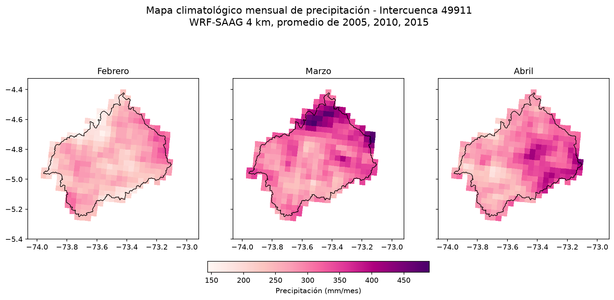

- **Marzo es el mes más lluvioso** en promedio (315 mm), seguido de abril (294 mm) y febrero (244 mm). En los tres años, febrero es el mes con más variación: va de 166 mm en 2005 a 373 mm en 2010.
- **La lluvia no es uniforme dentro de la cuenca.** El oeste y el suroeste (hacia Requena) reciben menos, unos 150–250 mm/mes. En marzo hay un núcleo de 400–480 mm/mes en el norte (hacia Nauta) y en abril se desplaza al este y sureste de la cuenca. Dentro de una cuenca de solo 4353 km², el acumulado FMA de una celda puede ser **2 a 3 veces** el de otra.
- Como el terreno es plano (90–180 m), esta estructura no viene del relieve. Es la huella de sistemas convectivos organizados que el modelo resuelve explícitamente a 4 km. Con solo tres años, parte de ese patrón todavía es "ruido" de unas pocas tormentas grandes, no un rasgo climatológico.

Mapas de cada año: [2005](../figures/mapas_total_2005.png), [2010](../figures/mapas_total_2010.png), [2015](../figures/mapas_total_2015.png). Días con lluvia: [2005](../figures/mapas_diaslluvia_2005.png), [2010](../figures/mapas_diaslluvia_2010.png), [2015](../figures/mapas_diaslluvia_2015.png).

## 2. Diferencias entre años

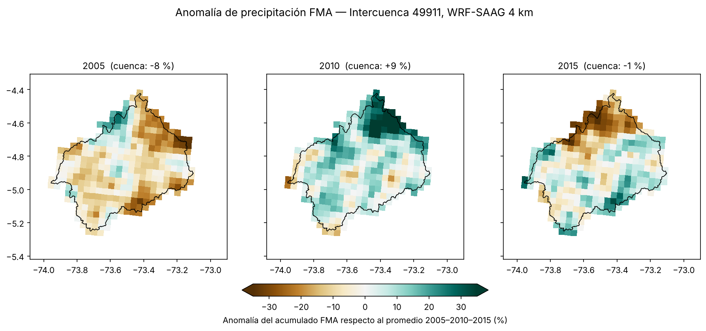

- **2010 es el FMA más lluvioso (+9 %)**, sobre todo por un febrero muy húmedo (373 mm, más del doble que en 2005). El exceso se concentra en el norte de la cuenca, donde pasa del +30 %.
- **2005 es el más seco (−8 %)**, con déficit en casi toda la cuenca y más marcado en el este. Su febrero fue el más seco de los tres, aunque abril fue el más lluvioso.
- **2015 queda en el promedio (−1 %)**, pero con un dipolo: el norte está seco (−20 a −30 %) y el centro-sur es más húmedo.
- **Las sequías amazónicas de 2005 y 2010 no se ven en FMA.** Esas sequías fueron sobre todo de la estación seca (julio a octubre) [12–15], y en febrero–abril 2010 es justamente el año más lluvioso. Para la sequía habría que mirar otros meses, y para El Niño 2015 su desarrollo posterior.

## 3. Variabilidad diaria, intensidad y extremos

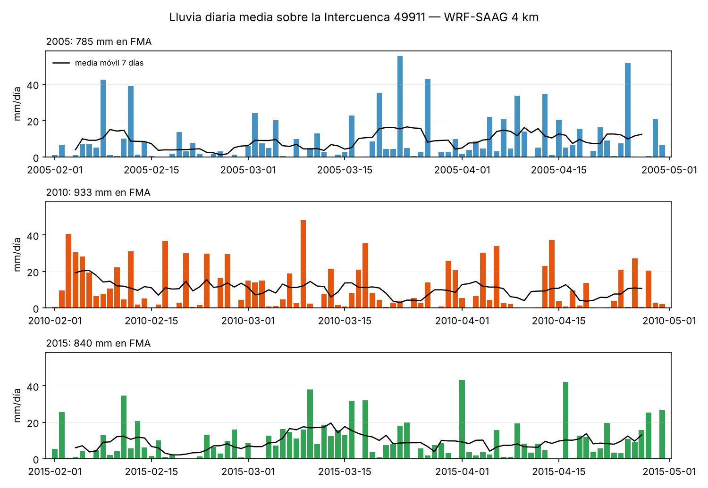

- La lluvia llega en **pulsos de 1–3 días** con 20–55 mm de media en la cuenca, separados por días casi secos. Es el comportamiento típico de la convección amazónica.
- **2005 es el año más concentrado:** el 43 % de su lluvia de FMA cayó en solo 8 días, y tiene el día más intenso de la cuenca (23 de marzo, 56 mm). Febrero y la primera mitad de marzo fueron muy secos.
- **2010 tiene más días fuertes:** 22 días con más de 20 mm en la media de la cuenca, y un inicio de febrero con lluvia casi diaria.
- **2015 llueve más seguido pero menos intenso:** es el año con más días de lluvia (70) y con la menor intensidad media y el menor percentil 95. Su lluvia está más repartida en el tiempo.

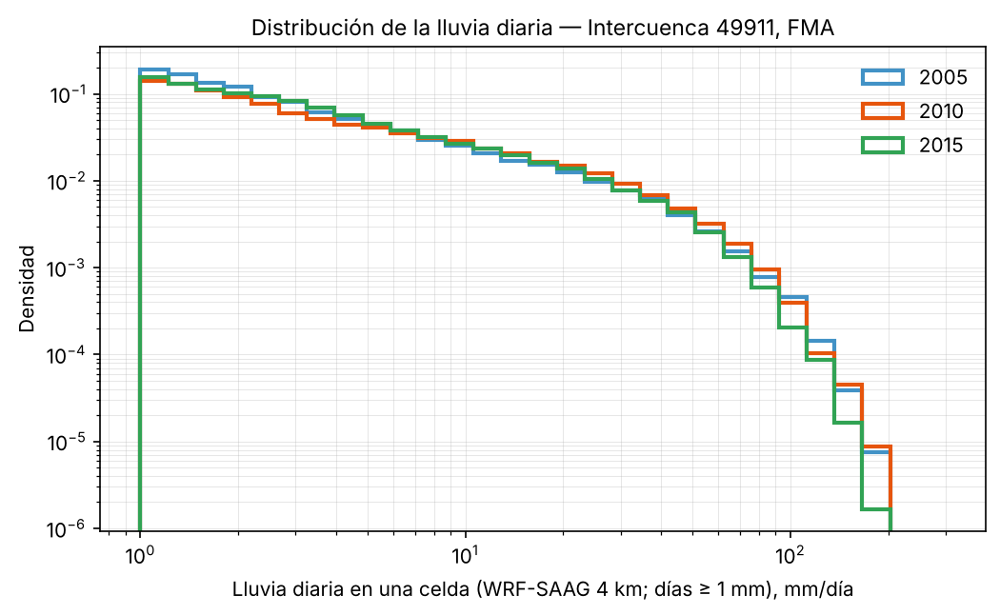

- Las distribuciones de lluvia diaria por celda son casi iguales hasta unos 50 mm/día. Las diferencias entre años aparecen en la cola: 2010 y 2005 tienen más días de más de 100 mm que 2015, y el máximo de una celda llega a 200 mm/día en 2010.
- Por celda, llueve (≥ 1 mm) en la mitad de los días de FMA (44–50 de 89). En cambio, la media de la cuenca supera 1 mm en 64–70 días: casi siempre está lloviendo en *alguna* parte de la cuenca.

## 4. Comparación con ERA5

ERA5 es el reanálisis que fuerza al WRF-SAAG en los bordes de su dominio continental. Compararlos muestra **qué cambia al resolver la convección explícitamente a 4 km** en vez de parametrizarla a ~31 km (pregunta 4). No dice cuál de los dos acierta; para eso falta PISCO. Se usó el mismo día pluviométrico en ambos, y la correlación desplazada ±1 día confirma que las fechas casan (máximo en 0 días). Números: `figures/era5_comparacion_resumen.csv` y `figures/era5_comparacion_mensual.csv`.

| | 2005 | 2010 | 2015 |
|---|---|---|---|
| Acumulado FMA, SAAG / ERA5 (mm) | 785 / 815 | 933 / 780 | 840 / 863 |
| Sesgo de SAAG respecto a ERA5 | **−4 %** | **+20 %** | **−3 %** |
| Correlación diaria / con media de 7 días | 0.14 / 0.51 | 0.24 / 0.31 | 0.19 / 0.31 |
| Días con lluvia ≥ 1 mm, SAAG / ERA5 | 64 / **84** | 65 / **79** | 70 / **86** |
| Días con más de 20 mm, SAAG / ERA5 | **15** / 7 | **22** / 6 | **10** / 6 |
| Percentil 95 diario, SAAG / ERA5 (mm) | **38** / 23 | **35** / 22 | **32** / 22 |
| Día máximo, SAAG / ERA5 (mm) | 56 / 48 | 48 / 31 | 43 / 32 |

**Totales parecidos, reparto diferente.** En 2005 y 2015 el acumulado de FMA casi coincide (−4 % y −3 %); en 2010 SAAG da un 20 % más. Las diferencias grandes están en **febrero** (2005: −39 %, 2010: **+75 %**, 2015: −18 %). En marzo, SAAG llueve algo más (+6 a +23 %) y abril es parecido (−8 a +6 %). El febrero muy húmedo de 2010 que se ve en SAAG **no aparece en ERA5**.

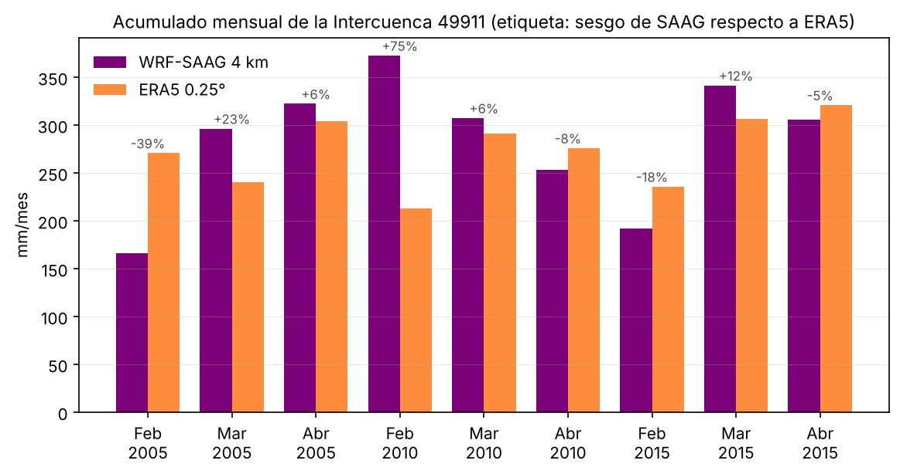

**El día a día casi no coincide**: la correlación diaria es de 0.14 a 0.24 y sube a 0.3–0.5 con medias semanales. Es lo esperable. El SAAG es una corrida continua de 20 años que recibe ERA5 en los bordes de un dominio continental, así que dentro del dominio desarrolla sus propias tormentas: reproduce la estación y los períodos húmedos y secos de varios días, pero no qué día exacto llueve sobre una cuenca de 4000 km².

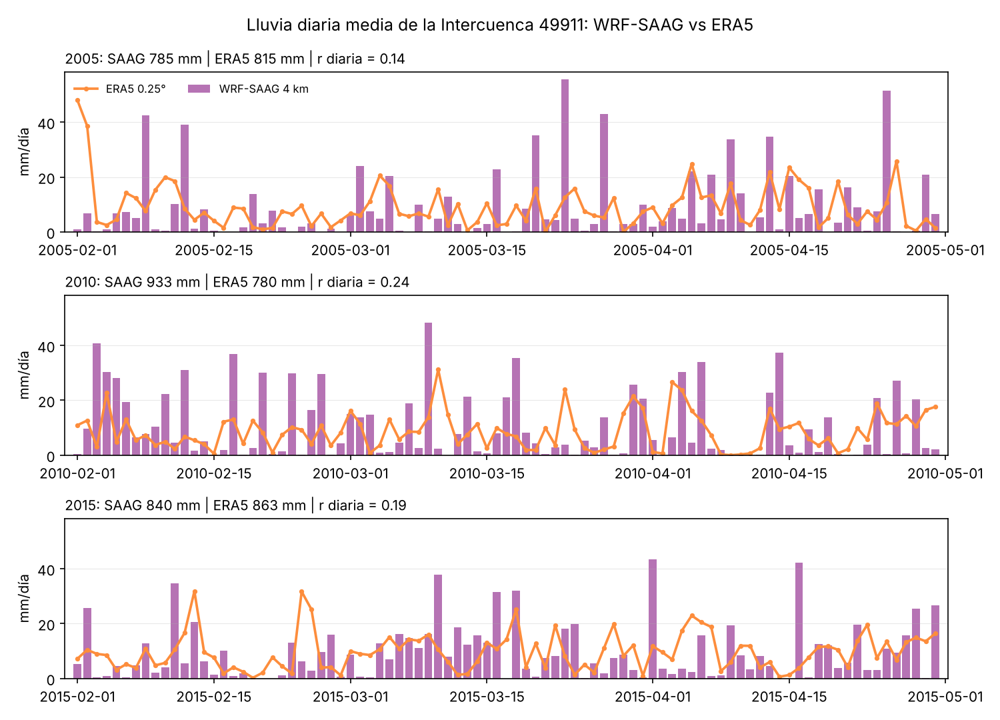

**La diferencia más clara es cómo llueve.** ERA5 llueve casi todos los días (79–86 de 89), pero suave: su percentil 95 es de unos 22 mm/día y solo tiene 6–7 días de más de 20 mm. SAAG tiene más días secos (64–70 con lluvia), pero sus eventos son más intensos: percentil 95 de 32–38 mm/día y entre 10 y 22 días de más de 20 mm. En la curva de excedencia, SAAG supera a ERA5 en el 30 % de días más lluviosos y queda por debajo en el resto. Es el contraste típico entre la convección parametrizada (lluvia demasiado frecuente y débil) y la convección resuelta (más intermitente e intensa) [11].

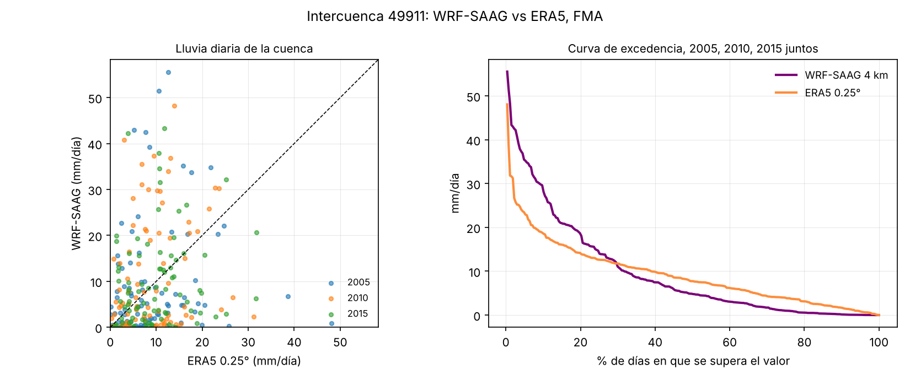

**Distribución espacial.** A 0.25°, ERA5 es casi uniforme sobre la cuenca (unos 750–900 mm en FMA). SAAG, incluso llevado a la misma malla, muestra un gradiente: más lluvia en el **este y noreste** (SAAG − ERA5 de +200 a +400 mm en 2010 y 2015) y menos en el **oeste** (−100 a −200 mm). Ese detalle interno de la cuenca solo lo da el modelo de 4 km. Si es real o un sesgo, lo dirá PISCO.

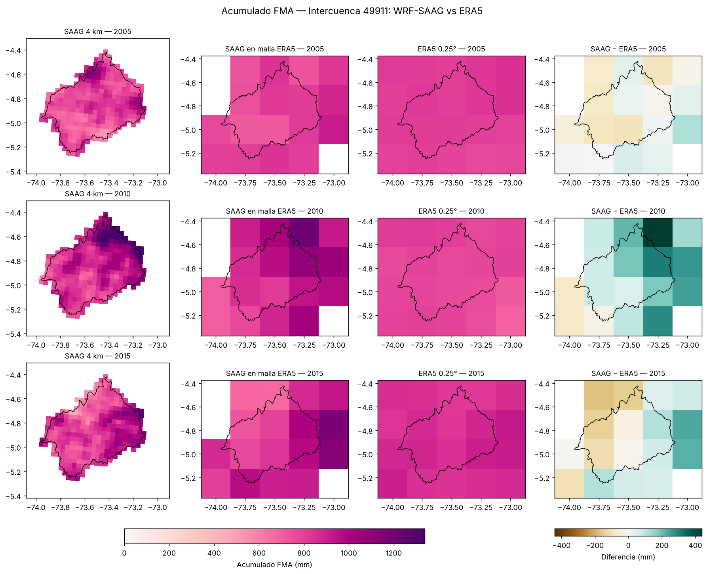

Nota: la descarga de ERA5 usada aquí cubre 4.5–5.25°S y 74–73°W (malla de 4×5). La celda de 0.25° del extremo norte no entra, y por eso queda fuera una franja de unos 5 km de la punta norte de la cuenca. Con la versión actual de `02_descargar_era5.py` esa celda ya se incluye.

## 5. Evaluación con PISCO v2.1 a escala de cuenca

PISCOp v2.1 (SENAMHI) combina pluviómetros, la climatología de radar y el satélite CHIRP a 0.1° [7]. Es la mejor referencia observacional disponible para Perú, pero en el llano amazónico hay pocas estaciones y depende más del satélite, así que también tiene incertidumbre. En la cuenca, el promedio usa 54 celdas de 0.1° ponderadas por el área que cae dentro (unas 36 celdas completas). Al desplazar PISCO ±1 día, la mejor correlación queda en 0 días: las fechas casan sin corrección, así que `PISCO_DESFASE_DIAS = 0`. Solo en 2015 la correlación es algo mayor desplazando un día, pero los otros años no lo confirman. Números: `figures/pisco_comparacion_resumen.csv`, `..._mensual.csv` y `figures/tres_fuentes_resumen.csv`.

| | 2005 | 2010 | 2015 |
|---|---|---|---|
| Acumulado FMA, SAAG / PISCO (mm) | 785 / 705 | 933 / 915 | 840 / **1032** |
| Sesgo de SAAG respecto a PISCO | +11 % | **+2 %** | **−19 %** |
| Correlación diaria / con media de 7 días | 0.06 / 0.15 | **0.43 / 0.60** | 0.20 / **0.72** |
| Días con lluvia ≥ 1 mm, SAAG / PISCO | 64 / 64 | 65 / 69 | 70 / 74 |
| Días con más de 20 mm, SAAG / PISCO | 15 / 9 | 22 / 14 | 10 / 16 |
| Percentil 95 diario, SAAG / PISCO (mm) | 38 / 40 | 35 / 46 | 32 / 37 |
| Día máximo, SAAG / PISCO (mm) | 56 / 60 | 48 / **76** | 43 / 53 |

**Totales:** el acumulado de FMA de SAAG queda **dentro de ±20 %** de PISCO en los tres años: +11 % en 2005, +2 % en 2010 y −19 % en 2015. Pero **el orden de los años no coincide**: PISCO tiene a **2015 como el FMA más lluvioso** (1032 mm), seguido de 2010 y 2005, mientras SAAG tiene a 2010 primero y subestima 2015. Sí coinciden en que 2005 es el más seco. Por meses, los errores son mayores y cambian de signo: abril de 2005 sale +68 %, febrero de 2005 −31 %, y febrero y marzo de 2015 −26 % y −24 %.

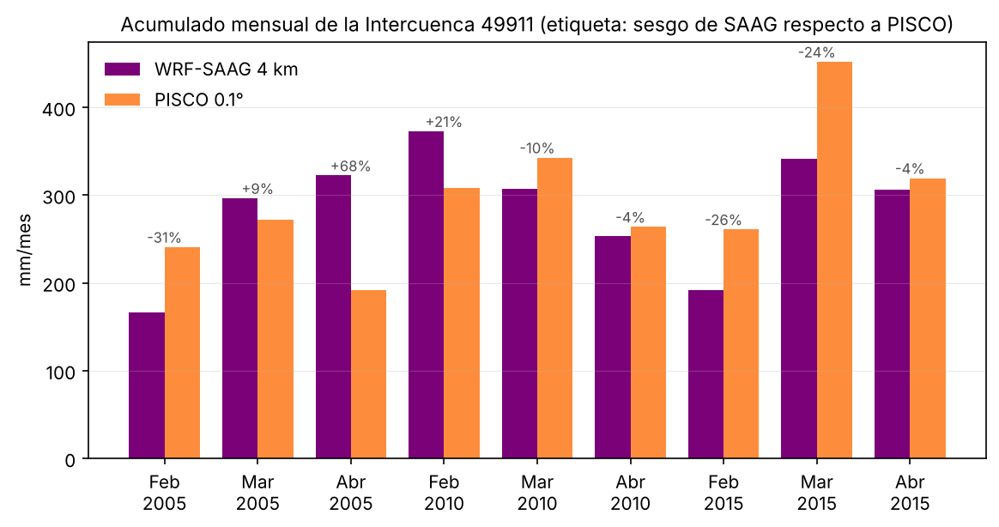

**Día a día:** la sincronía depende del año. En 2010 es buena (r = 0.43 diaria, 0.60 semanal): SAAG capta los eventos grandes de inicio de febrero y de abril. En 2015 casi no acierta el día exacto (0.20), pero sí los períodos húmedos y secos de una semana (r = 0.72). En 2005 no hay sincronía (0.06 / 0.15).

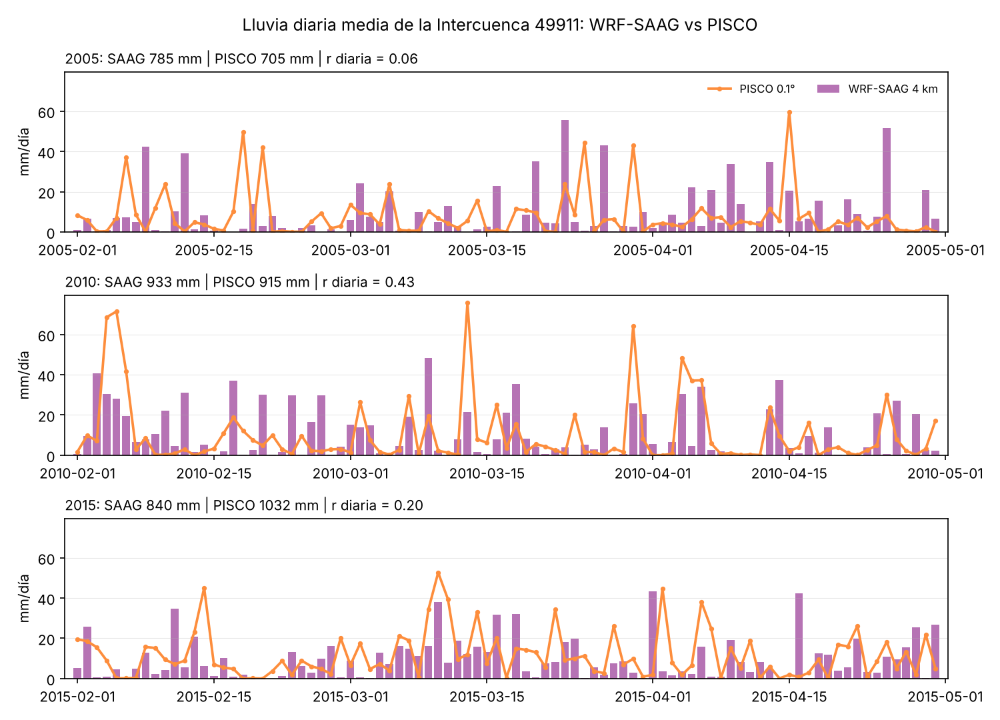

**Frecuencia e intensidad: lo mejor del modelo.** SAAG llueve casi la **misma cantidad de días** que PISCO (64–70 frente a 64–74), y su curva de excedencia se superpone con la de PISCO en casi todo el rango. La diferencia está en el extremo. PISCO tiene unos pocos días de lluvia generalizada sobre toda la cuenca más fuertes (máximos de 53–76 mm y percentil 95 de 37–46 mm) que SAAG (43–56 mm y 32–38 mm). SAAG, en cambio, tiene más días de 20–40 mm.

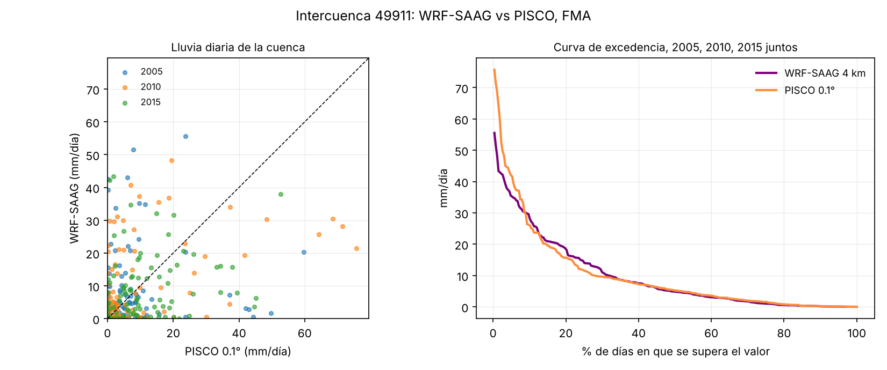

**Distribución espacial:** los patrones dentro de la cuenca no coinciden de forma sistemática entre años. En 2015, PISCO pone el máximo en el **norte y noreste** de la cuenca, más de 1200 mm, justo donde SAAG es más seco (SAAG − PISCO de −250 a −500 mm). En 2005, SAAG es más lluvioso al este y sureste. Con tres años y pocas estaciones en la zona, no se puede hablar todavía de un sesgo espacial fijo del modelo.

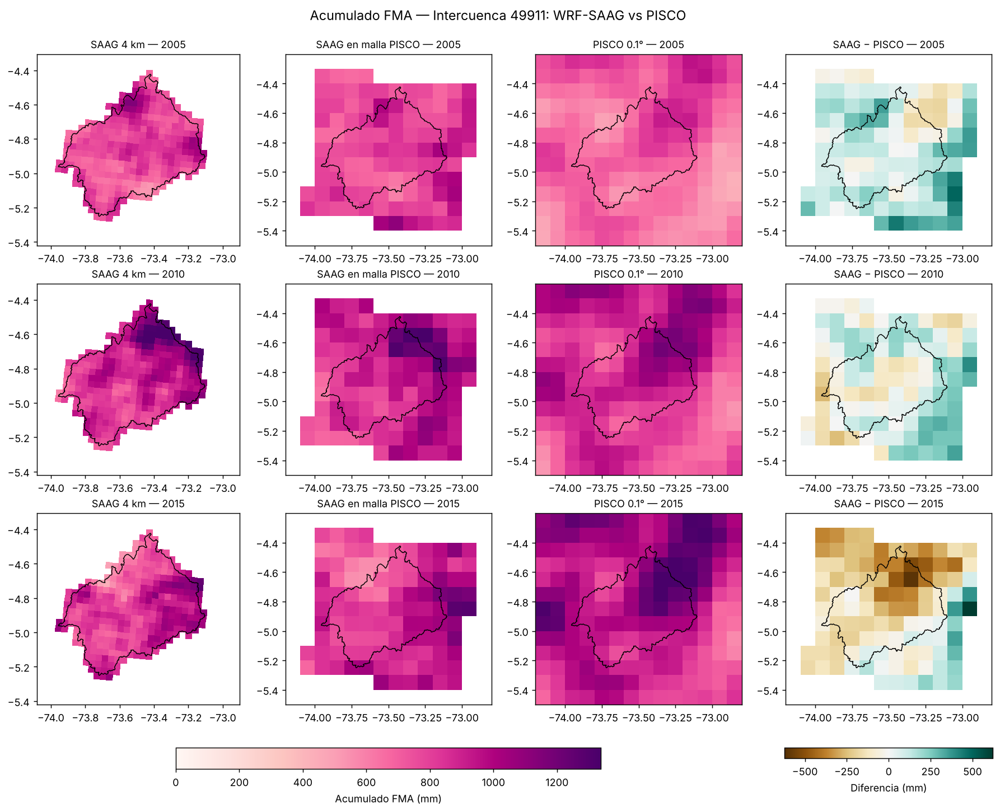

### PISCO con el mismo análisis que SAAG

Los mismos mapas y la misma serie diaria que en las secciones 1–3, hechos con PISCO para FMA de 2005, 2010 y 2015 (`python scripts/04_mapas_mensuales.py --fuente pisco --combinado` y `python scripts/07_analisis.py --fuente pisco`). Las figuras están en `figures/` con prefijo `pisco_`. La escala de color es la de cada fuente: para comparar valores, usar los mapas de diferencia de arriba.

| | 2005 | 2010 | 2015 |
|---|---|---|---|
| Acumulado FMA, media de la cuenca (mm) | 699 | 905 | **1022** |
| Anomalía respecto al promedio de los 3 años | **−20 %** | +3 % | **+17 %** |
| Febrero / Marzo / Abril (mm) | 241 / 266 / 192 | 308 / 334 / 263 | 262 / **442** / 319 |
| Días con lluvia ≥ 1 mm (media de la cuenca) | 64 | 70 | 76 |
| Día más lluvioso de la cuenca | 15-abr: 56 mm | 13-mar: **79 mm** | 10-mar: 50 mm |
| Lluvia en el 10 % de días más lluviosos | 45 % | 49 % | 31 % |

Los totales difieren en ~1 % de los de la tabla anterior: aquí se promedian por igual las 54 celdas que tocan la cuenca, y allá se ponderan por el área dentro de ella.

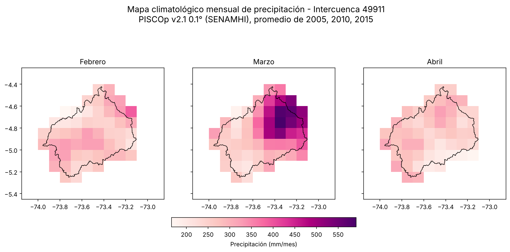

- **El núcleo de marzo en el noreste existe también en PISCO.** Es el máximo más marcado de los tres meses (más de 550 mm/mes), en la misma zona donde SAAG pone su máximo de marzo. Al oeste y suroeste llueve menos en las dos fuentes. Es el rasgo espacial más robusto que tenemos.
- **Entre años, PISCO va de 2005 (−20 %) a 2015 (+17 %)**, una variación mucho mayor que la de SAAG (−8 % a +9 %). Además, las anomalías de PISCO son casi uniformes en toda la cuenca, mientras que las de SAAG tienen manchas. El máximo de 2015 en PISCO viene sobre todo de marzo (442 mm).
- **Día a día**, PISCO muestra los mismos pulsos de 1–3 días. Los eventos más fuertes de 2010 (4–6 de febrero, 13 de marzo, 31 de marzo y 4–7 de abril) son más intensos que en SAAG, aunque SAAG sí tiene lluvia en varios de esos días.

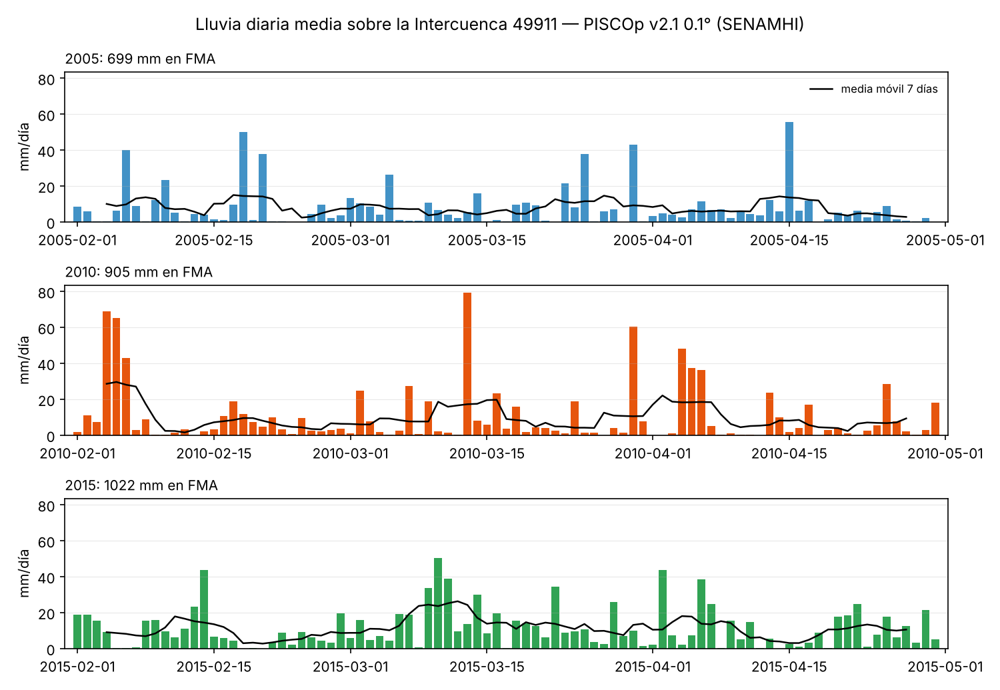
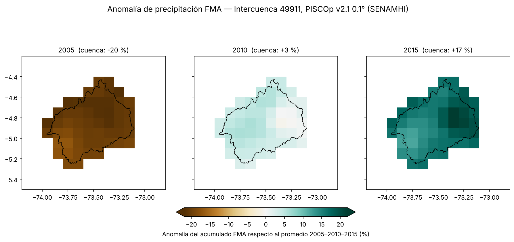

Mapas por año: [2005](../figures/pisco_mapas_total_2005.png), [2010](../figures/pisco_mapas_total_2010.png), [2015](../figures/pisco_mapas_total_2015.png). Como contexto de largo plazo, en `figures/pisco/` está la climatología mensual de PISCO de **1981–2005** (12 meses). No es directamente comparable con el promedio de nuestros tres años.

### ¿Mejora la convección explícita a ERA5? (pregunta 4)

Frente a PISCO, promediando los tres años (`python scripts/09_tres_fuentes.py`):

| | WRF-SAAG 4 km | ERA5 0.25° | PISCO |
|---|---|---|---|
| Error medio del acumulado FMA (valor absoluto) | **11 %** | 16 % | — |
| Correlación diaria con PISCO | 0.23 | **0.26** | — |
| Correlación con medias de 7 días | **0.49** | 0.37 | — |
| Días con lluvia ≥ 1 mm (por año) | **64–70** | 79–86 | 64–74 |
| Días con más de 20 mm (por año) | 10–22 | 6–7 | 9–16 |
| Percentil 95 diario (mm) | **32–38** | 22–23 | 37–46 |

- **Sí, en cómo llueve.** SAAG reproduce la frecuencia de días lluviosos y la intensidad de PISCO mucho mejor que ERA5. ERA5 llueve 10–20 días de más y su percentil 95 es apenas la mitad del observado: es el sesgo de "llovizna" de la convección parametrizada.
- **En los totales, SAAG también está algo más cerca** (11 % de error frente a 16 %), y sigue mejor las variaciones semanales (0.49 frente a 0.37).
- **En el día exacto, no.** ERA5 asimila observaciones y SAAG es una corrida libre, así que la correlación diaria es parecida y baja en los dos (~0.25).
- **Ninguno de los dos acierta el orden de los años:** según PISCO, 2015 fue el más lluvioso.

## 6. Estaciones y PISCO v3 (comparación de la presentación)

Comparación en el punto de dos estaciones de la plataforma ANDREA (ANA-SENAMHI) en el centro de la cuenca, a ~5 km entre sí: **Genaro Herrera** (−4.906, −73.650) y **Bagazán** (−4.910, −73.604). PISCO v3 [18] es la celda de 0.1° de la estación (la misma para ambas). WRF-SAAG es la celda de 4 km más cercana (a 1.1 y 2.0 km); la barra en las figuras es el rango de las 9 celdas vecinas (~12 × 12 km). Se reproduce con `python scripts/10_estaciones.py`; números en `figures/estaciones_resumen.csv` y día a día en `figures/estaciones_diaria.csv`.

| Acumulado FMA (mm) | 2005 | 2010 | 2015 | Días con lluvia en FMA |
|---|---|---|---|---|
| Genaro Herrera, observado | 631 | 799 | 749 | 48–51 |
| Bagazán, observado | 681 | 857 | 1090 | 31–37 |
| PISCO v3 (celda de ambas) | 684 | 792 | 798 | 68–76 |
| WRF-SAAG, celda de Genaro Herrera | 720 | 888 | 895 | 44–55 |
| WRF-SAAG, celda de Bagazán | 781 | 719 | 891 | 45–53 |

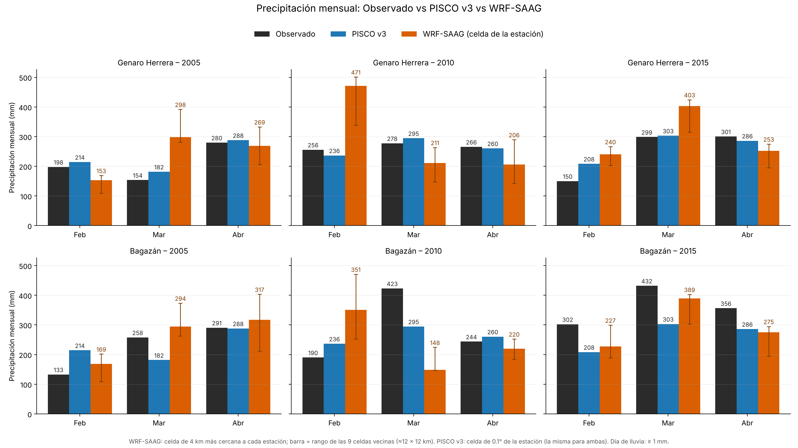

- **Acumulado:** WRF-SAAG queda dentro de ±20 % de lo observado (Genaro Herrera +11 a +19 %; Bagazán +15 a −18 %). PISCO v3 se acerca más (−8 a +8 %, salvo Bagazán 2015: −27 %). Observado y PISCO v3 coinciden en que 2005 fue el FMA más seco; WRF-SAAG también, salvo en Bagazán.
- **Meses:** los mayores errores de WRF están en 2010: febrero sobrestimado (351–471 mm frente a 190–256 observados) y marzo subestimado (148–211 frente a 278–423). En las estaciones, el mes más lluvioso es marzo o abril según el año (abril en 2005, marzo en 2010).

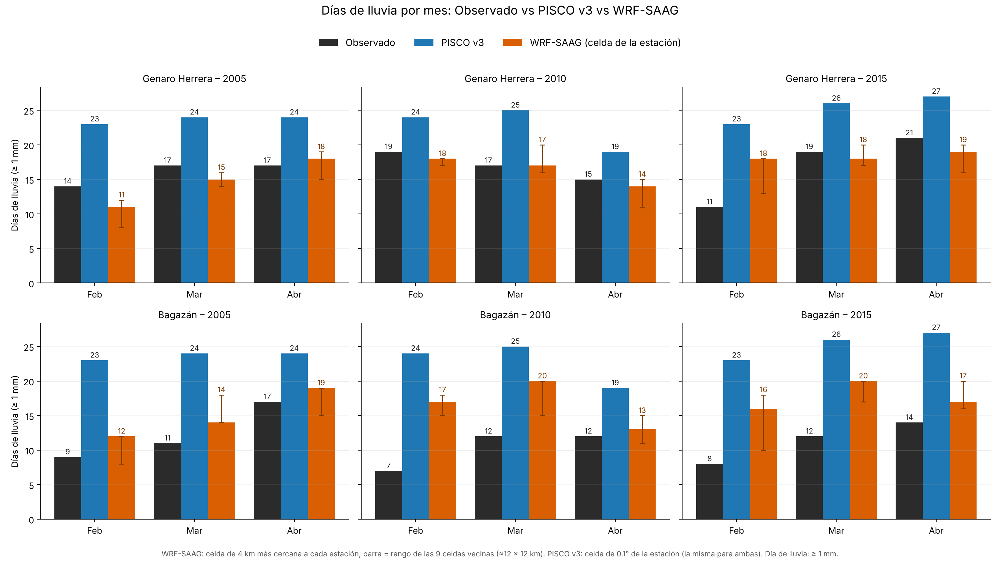

- **Frecuencia:** WRF-SAAG reproduce mejor los días de lluvia que PISCO v3. Las estaciones registran 31–51 días con lluvia en FMA, WRF 44–55 y PISCO v3 68–76: al interpolar, PISCO reparte la lluvia en casi todos los días.
- **Intensidad:** con los tres años juntos, el percentil 95 de los días con lluvia es 47 mm (Genaro Herrera) y 62 mm (Bagazán) observado, unos 50 mm en WRF-SAAG y 31 mm en PISCO v3, que suaviza los extremos.
- **Día a día:** PISCO v3 sigue casi exactamente a Bagazán (r = 0.79–0.89), así que probablemente la incluye y no es independiente de ella; con Genaro Herrera la correlación es 0.10–0.48. WRF-SAAG no acierta el día exacto (r = 0.01–0.39), como se espera de una corrida libre.
- **Calidad de Bagazán:** tiene 165 días en cero de 267, pocos días con lluvia y extremos de hasta 126 mm después de varios días en cero (29-03-2010), lo que sugiere posibles lecturas acumuladas de varios días.

## Conclusiones

Las tres primeras son las de la presentación (estaciones y PISCO v3); las siguientes vienen del análisis a escala de cuenca.

1. **Acumulado FMA:** en las estaciones, WRF-SAAG queda dentro de ±20 % de lo observado; PISCO v3 se acerca más (−8 a +8 %, salvo Bagazán 2015). Los mayores errores del modelo están en febrero y marzo de 2010.
2. **Cómo llueve:** WRF-SAAG reproduce mejor que PISCO v3 la frecuencia de días con lluvia y la intensidad de los extremos. PISCO, al interpolar, llueve casi todos los días y suaviza los máximos.
3. **Limitaciones:** PISCO v3 no es independiente de Bagazán (r ≈ 0.85), Bagazán tiene datos dudosos y, con 2 estaciones y 3 años, los resultados son indicativos.
4. **En la cuenca**, WRF-SAAG simula 780–930 mm en FMA, menos lluvia al oeste y núcleos al norte y este; el núcleo de marzo en el noreste también aparece en PISCO. Frente a ERA5, la convección explícita da menos días de lluvia y más intensos, y una estructura espacial que ERA5 no resuelve.
5. **Tres años no son una climatología.** La referencia climatológica es PISCO 1981–2005; lo que aquí se llama "climatología" es el promedio de 2005, 2010 y 2015, útil solo para comparar esos años entre sí.
6. Los máximos aislados de una sola celda (más de 150 mm/día) deben tomarse con cuidado: a 4 km una tormenta puede caer en un punto en el modelo y unos km más allá en la realidad.
